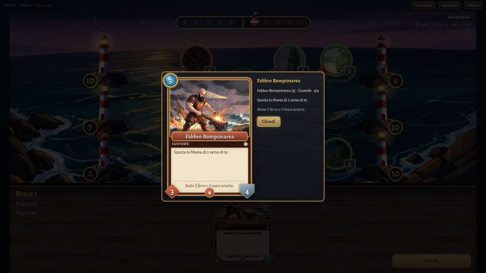
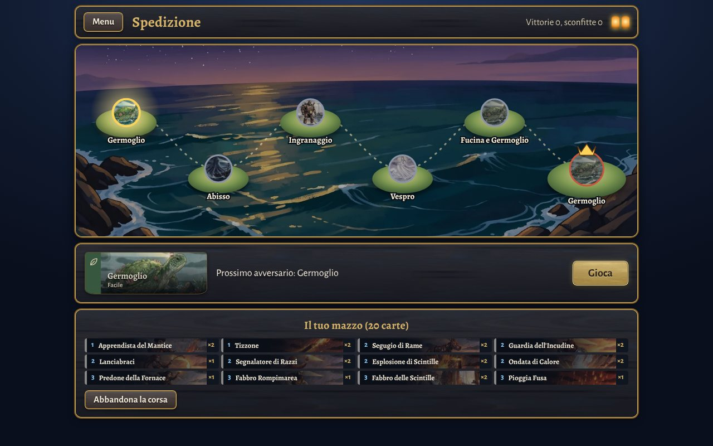
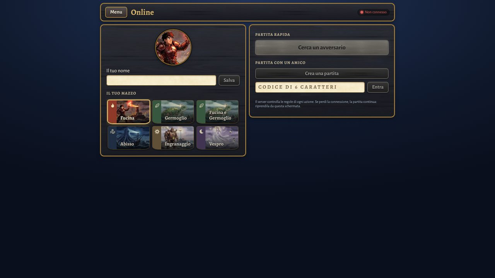
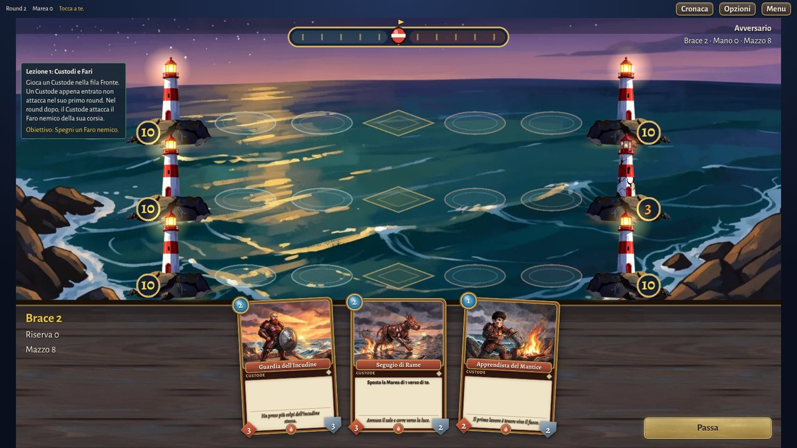
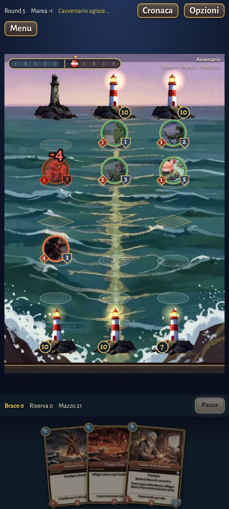

<p align="center">
  
</p>

<h1 align="center">High Tides</h1>

<p align="center"><em>Accendi i Fari. Domina la Marea.</em></p>

<p align="center">
  Gioco di carte collezionabili originale, nel browser e sul telefono.<br>
  Partite brevi, decisioni difficili, illustrazioni dipinte a mano.
</p>

---

## Il gioco in breve

Il mondo è un arcipelago dopo una grande inondazione.
Ogni comunità sopravvive intorno a un faro: la luce del faro protegge le isole dal buio del mare.
Tu sei un **Guardiano**. Difendi tre Fari e attacchi i Fari avversari con i tuoi **Custodi**.

- **Partite di 10-15 minuti**, con molte scelte in ogni turno.
- **154 carte** in 5 fazioni più le carte neutrali, tutte illustrate.
- **Tre corsie e due file**: la posizione di una carta cambia il suo valore.
- **Due risorse**: la Brace, tua, e la Marea, condivisa e contesa.
- **Giocatore singolo e online**: tutorial, sfida libera, Spedizione, Draft, partite con un amico.
- **Italiano e inglese**, nel browser del computer e dello smartphone. Tutto gratis.

<p align="center">
  
</p>

## Come si gioca

### L'obiettivo

Ogni giocatore ha **3 Fari**, uno per corsia. Ogni Faro ha 10 punti **Luce**.
Vinci quando spegni **2 Fari** avversari.
Devi scegliere ogni volta: concentrare l'attacco su una corsia o difendere ovunque.

### Il campo

```
        Corsia A     Corsia B     Corsia C
       [ Faro A ]   [ Faro B ]   [ Faro C ]     <- Avversario
       [Retro   ]   [Retro   ]   [Retro   ]
       [Fronte  ]   [Fronte  ]   [Fronte  ]
       ------------- Luoghi ---------------     <- 1 Luogo per corsia, condiviso
       [Fronte  ]   [Fronte  ]   [Fronte  ]
       [Retro   ]   [Retro   ]   [Retro   ]
       [ Faro A ]   [ Faro B ]   [ Faro C ]     <- Tu
```

- Un Custode in **Fronte** attacca e blocca. Un Custode in **Retro** è protetto, ma attacca solo con la Gittata.
- Ogni corsia può avere un **Luogo**. Il Luogo cambia le regole della corsia per entrambi i giocatori.
- Se la corsia avversaria non ha un Custode in Fronte, il danno va al Faro.

### Brace e Marea

La **Brace** è la tua risorsa. Il massimo cresce di 1 a ogni round, fino a 10.
A fine round conservi al massimo 2 Brace nella **Riserva**.

La **Marea** è un indicatore unico tra i due giocatori, da −5 a +5.
Molte carte spingono la Marea verso il proprio lato.
Le carte con **Alta Marea** diventano più forti quando la Marea è dalla tua parte di almeno 2 punti.
Le carte con **Riflusso** sono forti quando la Marea è dalla parte avversaria.

### Il round

1. **Alba.** Peschi 1 carta e ricarichi la Brace. L'Iniziativa passa all'altro giocatore.
2. **Manovra.** I giocatori agiscono a turno, un'azione alla volta: giocare una carta, spostare un Custode, passare.
3. **Scontro.** Il combattimento si risolve corsia per corsia, da A a C.
4. **Tramonto.** Gli effetti di fine round si risolvono. Dal round 14 la **Marea crescente** toglie 1 Luce a ogni Faro acceso.

Un **Rito Rapido** si gioca anche in risposta all'avversario. Le risposte formano una **catena** di massimo 4 carte.

### Le parole chiave

| Parola chiave | Effetto |
|---|---|
| **Radici** | Il Custode non si sposta. Ha +1 Tenuta in Fronte. |
| **Gittata** | Il Custode attacca anche dalla fila Retro. |
| **Travolgere** | Il danno in eccesso colpisce il Faro. |
| **Eco** | Quando il Custode muore, una copia 1/1 torna in mano. |
| **Usura** | Il Custode perde 1 Attacco a ogni Tramonto. |
| **Ancora** | La Marea non si sposta mentre il Custode è in gioco. |
| **Slancio** | Il Custode attacca anche nel round in cui entra. |

<p align="center">
  
</p>

## Le fazioni

Ogni fazione ha uno stile di gioco chiaro e un rapporto diverso con la Marea.
Un mazzo usa una o due fazioni, più le carte neutrali.

| Fazione | Tema | Stile di gioco | Rapporto con la Marea |
|---|---|---|---|
| 🔥 **Fucina** | Fuoco, rame, fabbri | Aggressivo, danno diretto ai Fari | Spinge la Marea in modo rapido ma instabile |
| 🌿 **Germoglio** | Alghe, coralli, crescita | Custodi che crescono, Radici, difesa | Effetti che durano più round |
| 🌊 **Abisso** | Mare profondo, creature cieche | Controllo, rimozione, pesca | Forte con il Riflusso |
| ⚙️ **Ingranaggio** | Meccanismi, orologi, fari | Reliquie e combinazioni | Blocca la Marea con l'Ancora |
| 🌙 **Vespro** | Nebbia, spiriti, lanterne | Sacrificio, cimitero, Eco | Guadagna valore quando la Marea cambia lato |
| ⚓ **Neutrali** | Marinai e gente delle isole | Carte di supporto per ogni mazzo | — |

Il primo set ha **154 carte**: 90 Custodi, 42 Riti (17 rapidi e 25 lenti), 16 Reliquie e 6 Luoghi.

<p align="center">
  
</p>

## Modalità di gioco

| Modalità | Cosa fai |
|---|---|
| **Tutorial** | 5 lezioni guidate. Ogni lezione introduce una regola con una posizione preparata. |
| **Sfida libera** | Scegli il tuo mazzo, il mazzo avversario e la difficoltà dell'IA: facile, media o difficile. |
| **Spedizione** | Campagna roguelite. Parti con un mazzo di 20 carte e affronti 6 avversari su una mappa. Dopo ogni vittoria scegli una carta nuova. Hai 2 vite. |
| **Draft** | Scegli due fazioni, poi costruisci un mazzo di 30 carte: a ogni passo prendi 1 carta su 3. Giochi fino a 7 vittorie o 3 sconfitte. |
| **Online** | Partita rapida contro un avversario, o partita con un amico tramite un codice di 6 caratteri. Il server controlla ogni azione. |
| **Collezione e Mazzi** | Guarda le carte, trasforma i doppioni in Frammenti, crea le carte che mancano e costruisci i tuoi mazzi. |

<table>
  <tr>
    <td width="50%"></td>
    <td width="50%"></td>
  </tr>
  <tr>
    <td><em>Spedizione: la mappa tra le isole e il tuo mazzo.</em></td>
    <td><em>Draft: a ogni passo prendi 1 carta su 3.</em></td>
  </tr>
  <tr>
    <td width="50%"></td>
    <td width="50%"></td>
  </tr>
  <tr>
    <td><em>Editor dei mazzi, con la curva dei costi.</em></td>
    <td><em>Online: partita rapida o codice per un amico.</em></td>
  </tr>
  <tr>
    <td width="50%"></td>
    <td width="50%"></td>
  </tr>
  <tr>
    <td><em>Tutorial: una regola per lezione.</em></td>
    <td><em>Fine partita.</em></td>
  </tr>
</table>

## Sul telefono

Sul telefono in verticale il gioco usa una **plancia verticale**: le corsie sono colonne, i tuoi Fari sono in basso e quelli avversari in alto.
La mano è un ventaglio sotto la plancia. Nelle Opzioni della partita puoi scegliere la plancia: Automatica, Orizzontale o Verticale.

<p align="center">
  
</p>

## La grafica

- **Illustrazioni dipinte** in stile gouache, coerenti tra loro: prima l'identità del gioco, poi quella di ogni fazione.
- Ogni immagine nasce da **modelli locali** su un PC di casa, mai da servizi esterni. Le regole di stile sono in [docs/guida-di-stile.md](docs/guida-di-stile.md).
- **Custodi come medaglioni** con l'anello della fazione, il respiro e la luce della fazione.
- **Animazioni fluide**: ingresso con compressione e rimbalzo, scatto in avanti, contraccolpo, numeri dei danni, particelle per ogni parola chiave, onde del mare con uno shader.
- **Accessibilità**: tastiera completa, testo per i lettori di schermo, opzione "Riduci le animazioni".
- **Prestazioni**: obiettivo 60 fotogrammi al secondo su un telefono di fascia media.

## Tecnologia

| Parte | Strumenti |
|---|---|
| Motore delle regole | TypeScript puro e deterministico, senza grafica. Test basati su proprietà e 500 partite simulate a ogni controllo. |
| Client | Svelte 5, PixiJS 8, GSAP, Vite. L'IA gira in un Web Worker. |
| IA | Tre livelli: euristica, ricerca, e ISMCTS (ricerca ad albero Monte Carlo con informazione nascosta). |
| Server PvP | Node.js, WebSocket, SQLite. Leggero: funziona anche su un Raspberry Pi 3B. |
| Lingue | i18next, con il testo delle regole generato dagli effetti delle carte. |
| Qualità | CI su GitHub: tipi, test unitari, validazione delle carte, test end-to-end con Playwright. |

## Provare il gioco

**Per installare e provare il gioco, leggi [docs/guida-installazione.md](docs/guida-installazione.md).**

### Requisiti

- Node.js 22
- pnpm 10 (`corepack enable` attiva la versione corretta)

### Comandi

1. Installa le dipendenze: `pnpm install`
2. Gioca nel browser: `pnpm dev`, poi apri l'indirizzo che Vite mostra.
3. Gioca online: avvia `pnpm start:server` in un secondo terminale, poi apri la schermata Online del client.
4. Gioca contro l'IA nel terminale: `pnpm play`
5. Scegli la lingua e i mazzi: `pnpm play --lang en --deck sprout --opponent forge`
6. Guarda una partita IA contro IA: `pnpm play --auto --seed 7`
7. Esegui tutti i controlli della CI: `pnpm check`

| Comando | Effetto |
|---|---|
| `pnpm typecheck` | Controlla i tipi TypeScript. |
| `pnpm test` | Esegue i test unitari e i test basati su proprietà. |
| `pnpm e2e` | Esegue i test end-to-end nel browser (Playwright). |
| `pnpm validate:cards` | Controlla i file delle carte. |
| `pnpm check:i18n` | Controlla che ogni testo esista in italiano e in inglese. |
| `pnpm build` | Crea il client statico in `packages/client/dist`. |
| `pnpm duel --a medium --b easy` | Confronta due livelli di IA. |
| `pnpm balance --games 20` | Gioca tutte le coppie di mazzi base e mostra le percentuali di vittoria. |
| `pnpm sim --games 500` | Simula 500 partite e controlla le regole dopo ogni azione. |
| `pnpm soak:pvp --games 100` | Gioca 100 partite PvP tramite il server e controlla la sincronizzazione. |
| `pnpm start:server` | Avvia il server PvP (porta 8787). |
| `pnpm smoke --url ws://host/ws --matches 10` | Gioca partite complete su un server installato e misura i tempi. |
| `pnpm build:server` | Crea il server in un solo file: `dist/server/server.mjs`. |
| `pnpm assets` | Ricostruisce le immagini web dagli originali (vedi [assets/README.md](assets/README.md)). |

I mazzi disponibili per `--deck` e `--opponent` sono `forge`, `sprout`, `forgeSprout`, `abyss`, `gear` e `vesper`.

## Struttura

| Pacchetto | Contenuto |
|---|---|
| `packages/engine` | Motore delle regole: puro, deterministico, senza grafica. |
| `packages/cards` | Dati delle carte (JSON), schema Zod, validatore, mazzi base. |
| `packages/i18n` | Testi in italiano e inglese, testo delle regole generato dagli effetti. |
| `packages/ai` | IA facile (euristica), IA media (ricerca), IA difficile (ricerca e ISMCTS) e giocatore casuale. |
| `packages/meta` | Collezione, Frammenti, Spedizione e Draft. |
| `packages/protocol` | Messaggi tra il client e il server PvP (Zod). |
| `packages/server` | Server PvP: WebSocket, SQLite, replay. Vedi [docs/server.md](docs/server.md). |
| `packages/client` | Gioco nel browser: Svelte, PixiJS, GSAP, IA in un Web Worker. Vedi [docs/client.md](docs/client.md). |
| `packages/tools` | Interfaccia testuale, simulatore, strumenti di controllo. |
| `assets` | Illustrazioni, mare, Fari e texture dell'interfaccia. Vedi [assets/README.md](assets/README.md). |

## Documenti

| Documento | Contenuto |
|---|---|
| [Piano di progetto](docs/piano-di-progetto.md) | Visione, regole complete, fazioni, architettura, roadmap. |
| [Piano della grafica](docs/piano-grafica.md) | Le fasi della grafica dipinta, dalla prima ancora alla plancia verticale. |
| [Guida di stile](docs/guida-di-stile.md) | Stile delle illustrazioni, formule dei prompt, colori delle fazioni. |
| [Animazioni](docs/animazioni.md) | Tempi e curve delle animazioni degli eventi. |
| [Motore](docs/motore.md) | Le scelte del motore delle regole. |
| [Client](docs/client.md) | Struttura del client, tema grafico, prestazioni. |
| [Server](docs/server.md) | Server PvP e installazione sul Raspberry Pi. |
| [Guida all'installazione](docs/guida-installazione.md) | Come installare e provare il gioco. |

## Licenza

Tutti i diritti riservati.
