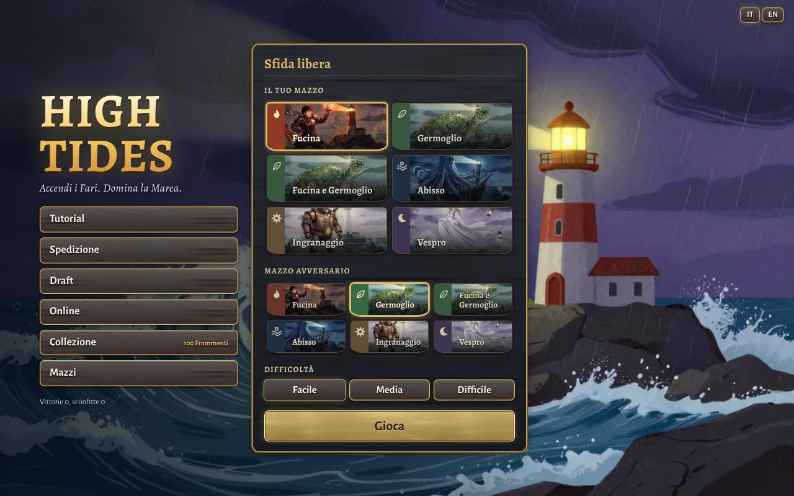
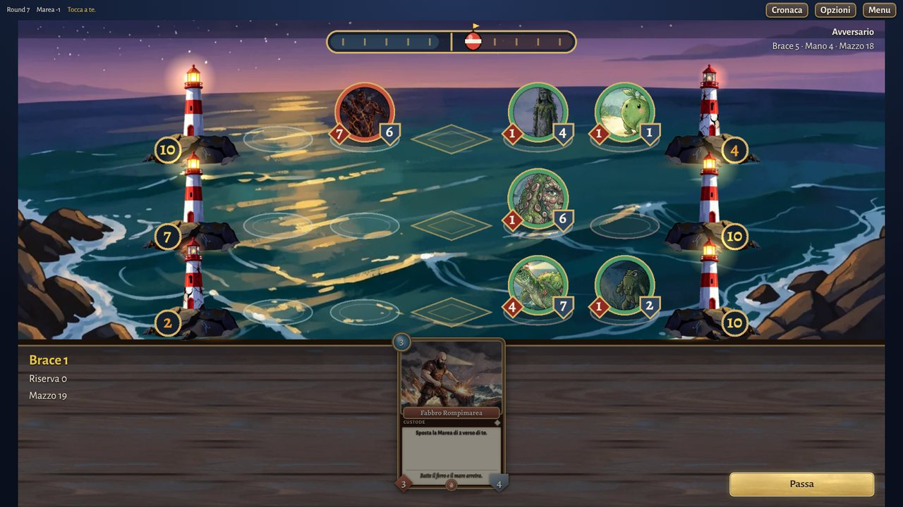
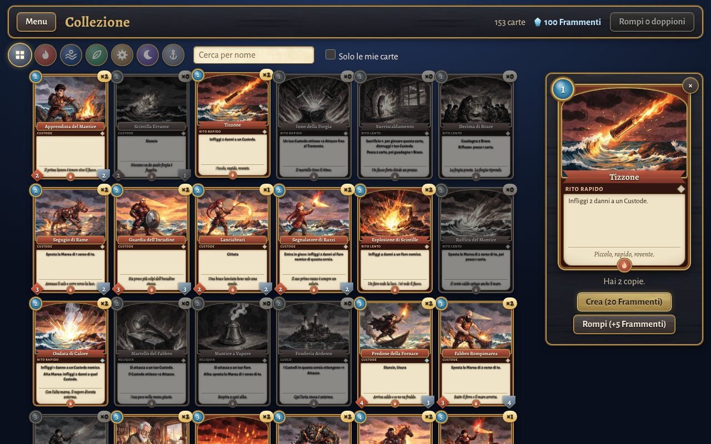
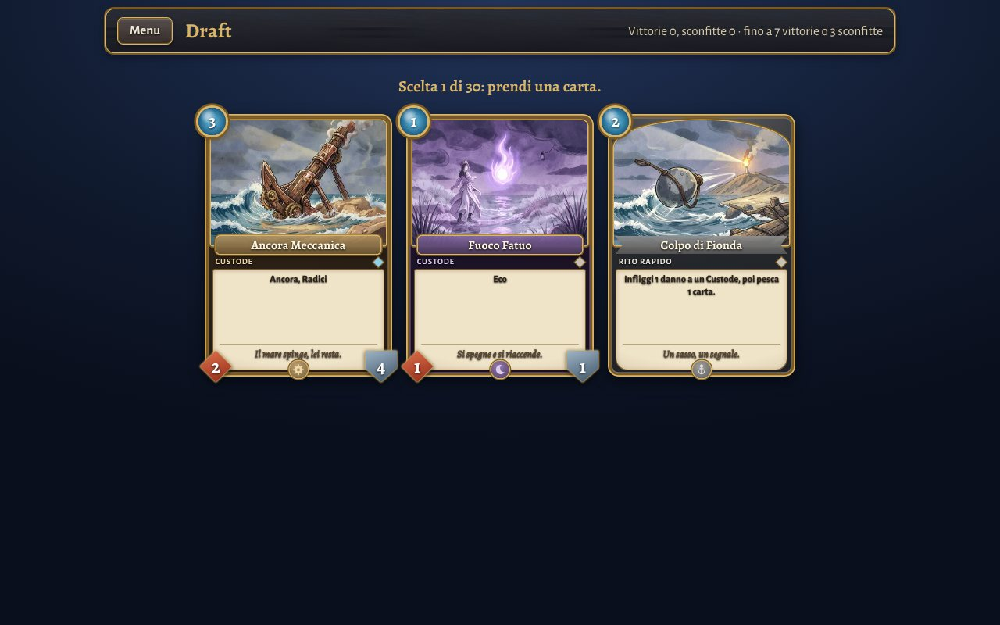
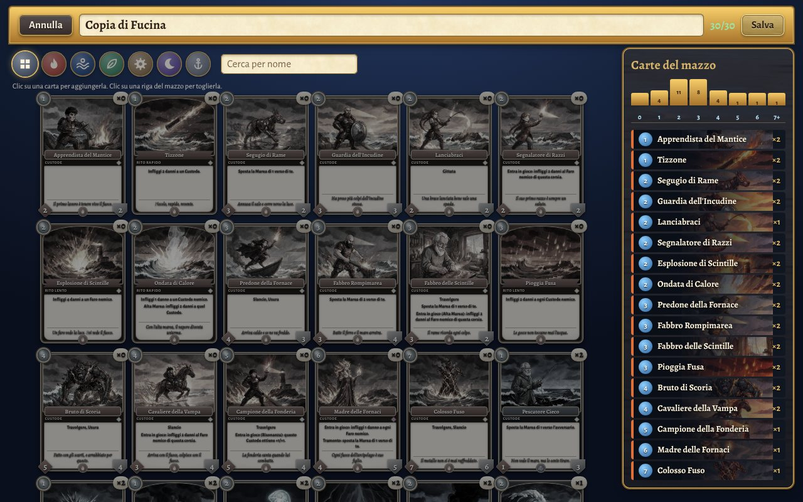
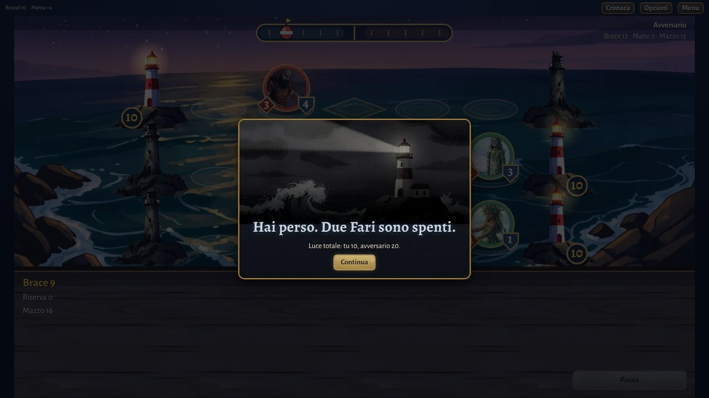

<p align="center">
  
</p>

<h1 align="center">High Tides</h1>

<p align="center"><em>Light the Beacons. Rule the Tide.</em></p>

<p align="center">
  An original collectible card game for the browser, on desktop and on smartphones.<br>
  Short matches, hard decisions, hand-painted illustrations.
</p>

<p align="center">
  <a href="docs/installation.md"><strong>Install and play</strong></a> ·
  <a href="#how-to-play">How to play</a> ·
  <a href="#game-modes">Game modes</a> ·
  <a href="#technology">Technology</a>
</p>

> **Note:** the screenshots in this README show the Italian interface. The game is fully available in English too.

---

## The game in brief

The world is an archipelago after a great flood.
Each community survives around a lighthouse: its light protects the islands from the dark sea.
You are a **Warden**. You defend three **Beacons** and attack the enemy Beacons with your **Keepers**.

- **10–15 minute matches**, with many choices in every turn.
- **154 cards** in 5 factions plus neutral cards, all illustrated.
- **Three lanes and two rows**: the position of a card changes its value.
- **Two resources**: **Ember**, which is yours, and the **Tide**, which both players share and fight over.
- **Single player and online**: tutorial, free match against the AI, Expedition, Draft, matches with a friend.
- **Two supported languages: English and Italian.** The game picks the language of your browser. You can change it in the menu.
- **Desktop and smartphone browsers.** No installation and no sign-up for players. Everything is free.

<p align="center">
  
</p>

## How to play

### The goal

Each player has **3 Beacons**, one for each lane. Each Beacon has 10 **Light** points.
You win when you put out **2 enemy Beacons**.
Every round you choose: focus the attack on one lane, or defend everywhere.

### The board

```
        Lane A       Lane B       Lane C
       [Beacon A]   [Beacon B]   [Beacon C]     <- Opponent
       [Back    ]   [Back    ]   [Back    ]
       [Front   ]   [Front   ]   [Front   ]
       --------------- Sites --------------     <- 1 Site per lane, shared
       [Front   ]   [Front   ]   [Front   ]
       [Back    ]   [Back    ]   [Back    ]
       [Beacon A]   [Beacon B]   [Beacon C]     <- You
```

- A Keeper in the **Front** row attacks and blocks. A Keeper in the **Back** row is protected, but it attacks only with Reach.
- Each lane can have one **Site**. A Site changes the rules of its lane for both players.
- If the enemy lane has no Keeper in the Front row, the damage goes to the Beacon.

### Ember and Tide

**Ember** is your resource. Your maximum Ember grows by 1 every round, up to 10.
At the end of a round you keep at most 2 Ember in your **Reserve**.

The **Tide** is a single track between the two players, from −5 to +5.
Many cards push the Tide toward their owner.
Cards with **High Tide** get stronger when the Tide is at least 2 points on your side.
Cards with **Ebb** are strong when the Tide is on the opponent's side.

### The round

1. **Dawn.** You draw 1 card and refill your Ember. The Initiative goes to the other player.
2. **Maneuver.** The players act in turns, one action at a time: play a card, move a Keeper, or pass.
3. **Clash.** Combat resolves lane by lane, from A to C.
4. **Dusk.** End-of-round effects resolve. From round 14, the **Rising Tide** removes 1 Light from each lit Beacon.

You can also play a **Quick Rite** in response to the opponent. Responses form a **chain** of at most 4 cards.

### Keywords

| Keyword | Effect |
|---|---|
| **Rooted** | The Keeper cannot move. It has +1 Hold in the Front row. |
| **Reach** | The Keeper also attacks from the Back row. |
| **Overrun** | Excess damage hits the Beacon. |
| **Echo** | When the Keeper dies, a 1/1 copy returns to your hand. |
| **Wear** | The Keeper loses 1 Attack at each Dusk. |
| **Anchor** | The Tide cannot move while the Keeper is in play. |
| **Surge** | The Keeper can attack in the round it enters. |

<p align="center">
  
</p>

## Factions

Each faction has a clear play style and a different relationship with the Tide.
A deck uses one or two factions, plus neutral cards.

| Faction | Theme | Play style | Relationship with the Tide |
|---|---|---|---|
| 🔥 **Forge** | Fire, copper, smiths | Aggressive, direct damage to Beacons | Pushes the Tide fast, but not for long |
| 🌿 **Sprout** | Kelp, coral, growth | Keepers that grow, Rooted, defense | Effects that last for several rounds |
| 🌊 **Abyss** | Deep sea, blind creatures | Control, removal, card draw | Strong with Ebb |
| ⚙️ **Gear** | Machines, clocks, lighthouses | Relics and combinations | Locks the Tide with Anchor |
| 🌙 **Vesper** | Mist, spirits, lanterns | Sacrifice, graveyard, Echo | Gains value when the Tide changes side |
| ⚓ **Neutral** | Sailors and island folk | Support cards for every deck | — |

The first set has **154 cards**: 90 Keepers, 42 Rites (17 Quick and 25 Slow), 16 Relics and 6 Sites.

<p align="center">
  
</p>

## Game modes

| Mode | What you do |
|---|---|
| **Tutorial** | 5 guided lessons. Each lesson teaches one rule with a prepared position. |
| **Free match** | Choose your deck, the opponent's deck and the AI difficulty: easy, medium or hard. |
| **Expedition** | A roguelite campaign. You start with a 20-card deck and face 6 opponents on a map. After each win you pick a new card. You have 2 lives. |
| **Draft** | Choose two factions, then build a 30-card deck: at each step you take 1 card out of 3. You play until 7 wins or 3 losses. |
| **Online** | Quick match against a random opponent, or a match with a friend through a 6-character code. The server checks every action. |
| **Collection and Decks** | Browse the cards, break extra copies into Shards, create the cards you are missing and build your decks. |

<table>
  <tr>
    <td width="50%"></td>
    <td width="50%"></td>
  </tr>
  <tr>
    <td><em>Expedition: the map of the islands and your deck.</em></td>
    <td><em>Draft: at each step you take 1 card out of 3.</em></td>
  </tr>
  <tr>
    <td width="50%"></td>
    <td width="50%"></td>
  </tr>
  <tr>
    <td><em>Deck editor, with the cost curve.</em></td>
    <td><em>Online: quick match or a code for a friend.</em></td>
  </tr>
  <tr>
    <td width="50%"></td>
    <td width="50%"></td>
  </tr>
  <tr>
    <td><em>Tutorial: one rule for each lesson.</em></td>
    <td><em>End of the match.</em></td>
  </tr>
</table>

## On your phone

On a phone in portrait orientation, the game uses a **vertical board**: the lanes are columns, your Beacons are at the bottom and the enemy Beacons are at the top.
Your hand is a fan below the board. In the match **Options** you can choose the board: Automatic, Horizontal or Vertical.

<p align="center">
  
</p>

## Art and feel

- **Painted illustrations** in a gouache style, consistent across the game: first a shared identity for the whole game, then one for each faction.
- **All images come from image models that run locally**, never from external image services.
- **Keepers as medallions**, with the faction ring, an idle "breathing" motion and the faction light.
- **Smooth animations**: entry with squash and bounce, forward lunge, recoil, damage numbers, particles for each keyword, sea waves drawn with a shader.
- **Accessibility**: full keyboard control, text for screen readers, a "Reduce animations" option.
- **Performance**: the target is 60 frames per second on a mid-range phone.

## Technology

| Part | Tools |
|---|---|
| Rules engine | Pure, deterministic TypeScript with no graphics. Property-based tests and 500 simulated games on every check. |
| Client | Svelte 5, PixiJS 8, GSAP, Vite. The AI runs in a Web Worker. |
| AI | Three levels: heuristic, search, and ISMCTS (Monte Carlo tree search with hidden information). |
| PvP server | Node.js, WebSocket, SQLite. Lightweight: it runs well on a single-board computer with 1 GB of RAM. |
| Languages | i18next. The rules text of each card is generated from the card effects, in English and in Italian. |
| Quality | GitHub CI: types, unit tests, card validation, end-to-end tests with Playwright. |

## Quick start

For the full guide, read **[docs/installation.md](docs/installation.md)**. It covers local play, online play, phone testing and self-hosting.

### Requirements

- Node.js 22.13 or later
- pnpm 10 (Corepack, included in Node.js, installs the correct version)
- Git

### Play in 4 steps

1. Clone the repository: `git clone https://github.com/fedeveloper/tcg.git`
2. Go into the folder and enable pnpm: `cd tcg && corepack enable`
3. Install the dependencies: `pnpm install`
4. Start the game: `pnpm dev`, then open `http://localhost:5173/`.

To play online, start the PvP server in a second terminal with `pnpm start:server` (port 8787). Then open the **Online** screen in the game.

### Useful commands

| Command | Effect |
|---|---|
| `pnpm dev` | Starts the browser client with Vite (port 5173). |
| `pnpm start:server` | Starts the PvP server (port 8787). |
| `pnpm play` | Plays against the AI in the terminal. |
| `pnpm play --lang en --deck sprout --opponent forge` | Chooses the language and the decks in the terminal game. |
| `pnpm play --auto --seed 7` | Shows an AI-against-AI match in the terminal. |
| `pnpm check` | Runs all the CI checks. |
| `pnpm typecheck` | Checks the TypeScript types. |
| `pnpm test` | Runs the unit tests and the property-based tests. |
| `pnpm e2e` | Runs the end-to-end tests in the browser (Playwright). |
| `pnpm validate:cards` | Checks the card data files. |
| `pnpm check:i18n` | Checks that each text exists in English and in Italian. |
| `pnpm build` | Builds the static client into `packages/client/dist`. |
| `pnpm build:server` | Builds the server into one file: `dist/server/server.mjs`. |
| `pnpm duel --a medium --b easy` | Compares two AI levels. |
| `pnpm balance --games 20` | Plays all pairs of starter decks and shows the win rates. |
| `pnpm sim --games 500` | Simulates 500 games and checks the rules after each action. |
| `pnpm soak:pvp --games 100` | Plays 100 PvP matches through the server and checks the synchronization. |
| `pnpm smoke --url ws://host/ws --matches 10` | Plays complete matches on an installed server and measures the response times. |
| `pnpm assets` | Rebuilds the web images from the originals (see [assets/README.md](assets/README.md)). |

The decks for `--deck` and `--opponent` are `forge`, `sprout`, `forgeSprout`, `abyss`, `gear` and `vesper`.

## Repository structure

| Package | Content |
|---|---|
| `packages/engine` | Rules engine: pure, deterministic, no graphics. See [docs/engine.md](docs/engine.md). |
| `packages/cards` | Card data (JSON), Zod schema, validator, starter decks. |
| `packages/i18n` | English and Italian texts, rules text generated from the card effects. |
| `packages/ai` | Easy AI (heuristic), medium AI (search), hard AI (search and ISMCTS) and a random player. |
| `packages/meta` | Collection, Shards, Expedition and Draft. |
| `packages/protocol` | Messages between the client and the PvP server (Zod). |
| `packages/server` | PvP server: WebSocket, SQLite, replays. See [docs/server.md](docs/server.md). |
| `packages/client` | Browser game: Svelte, PixiJS, GSAP, AI in a Web Worker. See [docs/client.md](docs/client.md). |
| `packages/tools` | Terminal interface, simulator, test tools. |
| `assets` | Illustrations, sea, Beacons and interface textures. See [assets/README.md](assets/README.md). |
| `deploy` | systemd units, Caddy configuration, Docker image and deploy script. |

## Documentation

| Document | Content |
|---|---|
| [Installation guide](docs/installation.md) | How to install, play, test and self-host the game. |
| [Rules engine](docs/engine.md) | Engine API, effect language, rules decisions, AI. |
| [Client](docs/client.md) | Client structure, graphic theme, accessibility, performance. |
| [PvP server](docs/server.md) | Server design, configuration, database, security. |
| [Animations](docs/animations.md) | Timing and curves of the event animations. |
| [Assets](assets/README.md) | Image folders and how to rebuild the web images. |

The `docs` folder also contains the internal planning notes of the project (`piano-*.md`) and the art style guide (`guida-di-stile.md`). These files are in Italian.

## License

All rights reserved.
