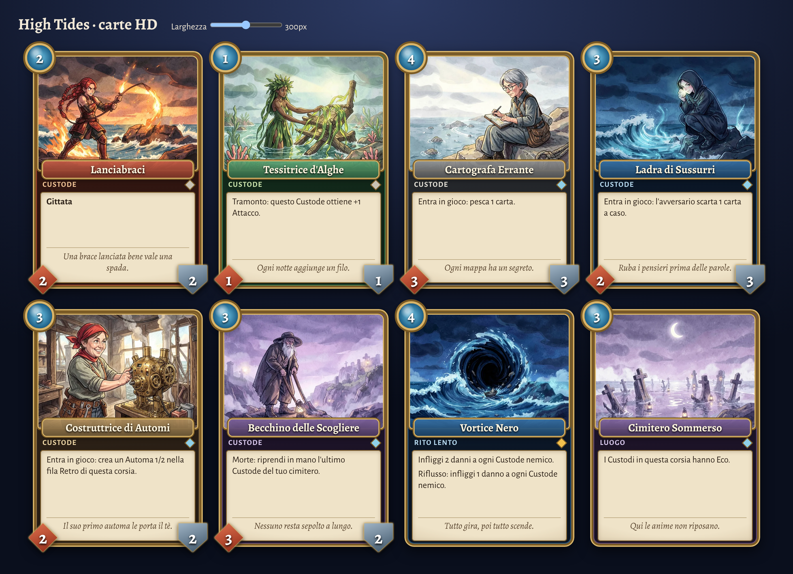

# Guida di stile

Questa guida fissa le regole grafiche di **High Tides**: illustrazioni dipinte HD e interfaccia in SVG e CSS.
Ogni nuovo asset rispetta queste regole.
Il piano completo è in [piano-grafica.md](piano-grafica.md).

NOTA: questa guida sostituisce la guida della pixel art (17/11/2026). La versione pixel art resta nella cronologia di git. Gli asset pixel in [`assets/src/`](../assets/README.md) restano nel gioco fino alla loro sostituzione.

## 1. Regole di base

- **Pittura 2D a guazzo.** Pennellate morbide e visibili, colore ricco, silhouette chiare. Niente fotorealismo e niente pixel art.
- **Luce come tema.** Ogni illustrazione ha una luce calda (faro, fuoco, lanterna) contro un mare freddo.
- **Personaggi leggibili.** Il soggetto sta in un terzo dell'immagine. Il volto si vede quando il soggetto è un personaggio.
- **Colori di fazione.** I colori dominanti della fazione coprono almeno metà dell'immagine.
- **Niente testo.** Le illustrazioni non contengono lettere, numeri o simboli scritti.
- **Solo modelli locali.** Le immagini nascono con `local-image-mcp` sull'OMEN di Federico, solo quando Federico è presente.

## 2. Ancore

Le ancore sono immagini approvate da Federico. Ogni generazione usa 2 riferimenti: l'ancora del gioco e l'ancora della fazione.

| Livello | Ancora | File sull'OMEN (in `Pictures\local-image\generated-images\`) |
|---|---|---|
| Gioco | 3B, faro nella tempesta | `20261117-140922_z-image-turbo_103.png` |
| Fucina | F1, Campione della Fonderia | `tcg-fase1\forge-011.png` |
| Germoglio | G2, Tartaruga Muschiata | `tcg-fase1\sprout-008.png` |
| Neutrale | N1, Capitano Veterano | `tcg-fase1\neutral-006.png` |
| Abisso | A2, Calamaro Colossale | `tcg-fase1\abyss-012.png` |
| Ingranaggio | I2, Gigante di Rame | `tcg-fase1\gear-011.png` |
| Vespro | V2, Regina delle Lanterne Spente | `tcg-fase1\vesper-013.png` |

ATTENZIONE: non usare l'ancora 2B (il ragazzo sul molo) come riferimento. Il modello copia il ragazzo in ogni carta.

## 3. Fazioni

| Fazione | Frase della fazione (nel prompt) | Colore principale | Icona | Forma |
|---|---|---|---|---|
| Fucina | soot dark red, rust, ember orange, flame and golden glow, warm firelight dominates | `#c8553d` | Fiamma | Triangolo |
| Germoglio | dark kelp green, moss green, fresh sprout green and coral pink, living sea plants everywhere | `#4f9d69` | Germoglio | Cerchio |
| Neutrale | slate, stone gray, sand and white, plain harbor materials, weathered wood and rope | `#8a8a8a` | Stella a 4 punte | Stella |
| Abisso | abyss navy, deep blue, sea blue, mist and pale foam, cold bioluminescent light in darkness | `#2d6ba3` | Goccia | Goccia |
| Ingranaggio | dark wood, polished copper, tan and sand, brass gears and steam | `#b08d57` | Ruota dentata | Quadrato |
| Vespro | dusk purple, violet, lilac, with pale ghostly glow and white, mist and lanterns | `#7a5c99` | Falce di luna | Rombo |

La forma aiuta i giocatori daltonici. I colori della cornice sono in [`HdCard.svelte`](../packages/client/src/ui/HdCard.svelte) (variabili `--c`, `--d`, `--l`).

## 4. Prompt

Ogni prompt ha 4 parti, in questo ordine:

1. **Regola dei riferimenti:** `Use images 1 and 2 only as a reference for painting style, brushwork, line work, lighting and color treatment. Do not copy their characters, faces, buildings or composition.`
2. **Soggetto:** `New card illustration: <soggetto>`. Usa il modello del tipo di carta (tabella sotto).
3. **Frase della fazione:** `Faction colors: <frase della sezione 3>.`
4. **Frase di stile del gioco:** `Painterly 2D game illustration in gouache style, visible soft brush strokes, rich textured color, bold readable silhouettes, strong rim light, adventurous storybook mood, no text, no letters.`

| Tipo | Modello del soggetto |
|---|---|
| Custode | `<chi è, aspetto, abiti> <azione tipica della carta> in <luogo sul mare>, character in the left third, face visible.` |
| Rito Rapido | `<un gesto o un attimo magico>: <cosa succede>, dynamic close view, motion and light trails.` |
| Rito Lento | `<un evento grande>: <cosa cambia nel mare o nel cielo>, wide view, dramatic sky.` |
| Reliquia | `<l'oggetto> resting on <superficie>, close still-life view, object centered, warm light on its details.` |
| Luogo | `<il luogo>, wide establishing view, small figures for scale, lanterns or beacon light.` |

Per un Custode con un'emozione (per esempio "Lanciabraci"), scrivi l'emozione del volto: `her face visible and fierce`.

## 5. Parametri di generazione

| Parametro | Valore |
|---|---|
| Modello | `flux2-klein-4b` |
| Riferimenti | `[ancora del gioco, ancora della fazione]` |
| Misura | 1344 × 960 (rapporto 7:5) |
| Seme | Un numero nuovo per ogni carta. Scrivi il seme nel file `meta`. |
| File di uscita | `Pictures\local-image\generated-images\tcg-<lotto>\<cardId>.png` |
| Tempo | circa 32 secondi per immagine |

**Rifacimento.** Il modello a volte copia il personaggio dell'ancora della fazione (il vecchio marinaio dei Neutrali, il polpo dell'Abisso, il golem di rame degli Ingranaggi). In questo caso rifai l'immagine con un seme nuovo e con la sola ancora del gioco (3B) come riferimento. Scrivi la regola dei riferimenti al singolare: `Use image 1 only as a reference for painting style, brushwork, line work, lighting and color treatment. Do not copy its buildings or composition.` Descrivi nel soggetto i tratti del personaggio (età, capelli, abiti) e scrivi `no armor` se serve. Nel file `meta` scrivi la formula `rifacimento (solo 3B)`.

Se il soggetto non chiede un faro, aggiungi dopo la regola dei riferimenti: `Do not paint any lighthouse, tower or house unless the description asks for one.`

Durante ogni lotto, mostra a Federico una barra di avanzamento con il numero di immagini finite e il tempo stimato.

## 6. Carta

La carta HD è il componente [`HdCard.svelte`](../packages/client/src/ui/HdCard.svelte). Il rapporto della carta è 5:7.

| Parte | Regola |
|---|---|
| Illustrazione | In alto, rapporto 7:5, bordo d'oro |
| Costo | Gemma blu in alto a sinistra |
| Nome | Targa nel colore della fazione, font Alegreya grassetto |
| Tipo e rarità | Riga in maiuscolo; gemma della rarità a destra (grigia, azzurra, oro, magenta) |
| Testo | Pergamena: parole chiave in grassetto, poi le regole, poi la frase di colore in corsivo |
| Attacco | Rombo rosso in basso a sinistra (solo Custodi) |
| Tenuta | Scudo grigio-blu in basso a destra (solo Custodi) |
| Emblema | Medaglione in basso al centro, con il simbolo della fazione in SVG |
| Cornice del Rito | Illustrazione ad arco, nome su un nastro, pergamena con il bordo inferiore arrotondato |
| Riflesso | Solo carte rare e leggendarie, fuori dalla mano. Fermo con "movimento ridotto" |

Il dorso della carta è [`CardBack.svelte`](../packages/client/src/ui/CardBack.svelte).

Per vedere tutte le carte HD, apri `localhost:5173/#carte-hd`.

### Medaglione del Custode

Sul campo un Custode è un medaglione rotondo, ritagliato dalla sua illustrazione. Il punto di ritaglio è in [`assets/art/crops.json`](../assets/art/crops.json): centro `x` e `y` (da 0 a 1 della larghezza e dell'altezza) e raggio `r` (da 0 a 1 dell'altezza). Il medaglione mostra il volto e le spalle. Per un animale o un oggetto, mostra la testa o la parte più riconoscibile. I medaglioni dell'avversario sono specchiati, così guardano verso il centro.

## 7. Font

| Font | Uso | Licenza |
|---|---|---|
| Alegreya (700, 400 corsivo) | Titoli, nomi delle carte, numeri | OFL |
| Alegreya Sans (400, 700) | Testi, interfaccia | OFL |

I font arrivano dai pacchetti `@fontsource/alegreya` e `@fontsource/alegreya-sans`. Coprono le lettere accentate dell'italiano.

## 8. Come aggiungere un'illustrazione

1. Scrivi il prompt con le regole della sezione 4.
2. Genera l'immagine con i parametri della sezione 5.
3. Mostra l'immagine a Federico e ottieni la sua approvazione.
4. Copia l'originale in `assets/art/originals/<cardId>.png`.
5. Scrivi `assets/art/meta/<cardId>.json` con modello, seme, riferimenti e prompt.
6. Se la carta è un Custode, aggiungi il suo punto di ritaglio in `assets/art/crops.json`.
7. Esegui `corepack pnpm art`.
8. Controlla la carta in `localhost:5173/#carte-hd`.

## 9. Kit dell'interfaccia

Il kit è in [`global.css`](../packages/client/src/ui/global.css). Ogni schermata usa il kit senza importare componenti.

| Elemento | Come usarlo | Aspetto |
|---|---|---|
| Pulsante | `<button>` | Legno con cornice d'ottone. Stati: normale, sopra (più chiaro), premuto (più scuro, scende di 1 px), disattivato (grigio) |
| Pulsante principale | `<button class="primary">` | Ottone con testo scuro e alone dorato |
| Select | `<select>` | Legno incassato, freccia dorata |
| Campo di testo | `<input type="text">` | Pergamena incassata |
| Pannello | `class="panel"` | Legno scuro con cornice d'ottone |
| Pannello di testo | `class="panel paper"` | Pergamena con cornice d'ottone |
| Suggerimento | `data-tip="testo"` | Pergamena sopra l'elemento, al passaggio del mouse e con il focus della tastiera |

Le texture sono in `assets/ui/web/` (512 × 512, ripetibili). Per crearle:

1. Genera la texture con `z-image-turbo`, 1024 × 1024, con la frase `Seamless flat texture of ...`.
2. Copia l'originale in `assets/ui/originals/<nome>.png`.
3. Esegui `python3 assets/ui/build.py`. Lo script ritaglia il centro e rende i bordi continui.

| Texture | Seme | Uso |
|---|---|---|
| `legno` | 401 | Pulsanti, select, pannelli |
| `pergamena` | 402 | Campi di testo, suggerimenti, regole delle carte |
| `ottone` | 403 | Pulsante principale |
