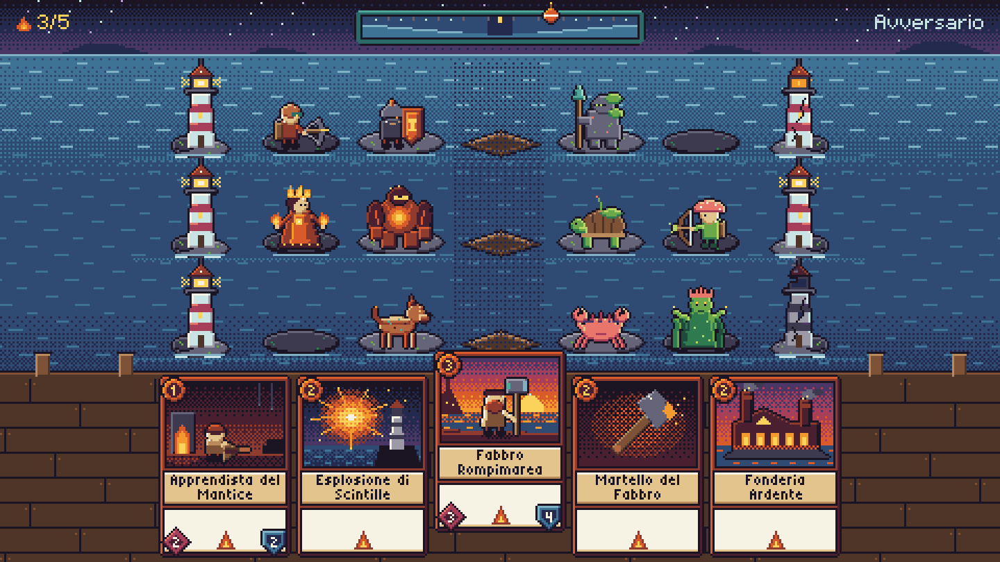
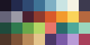
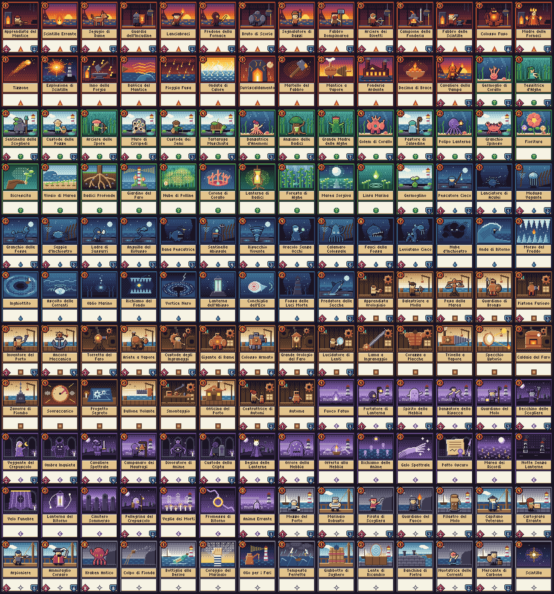
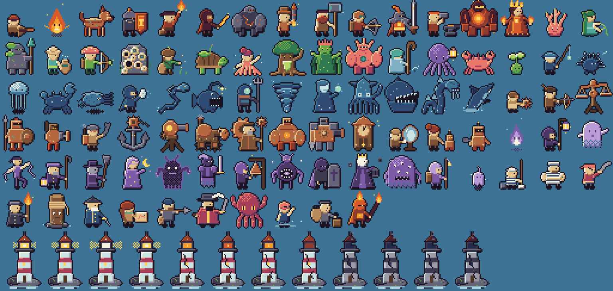
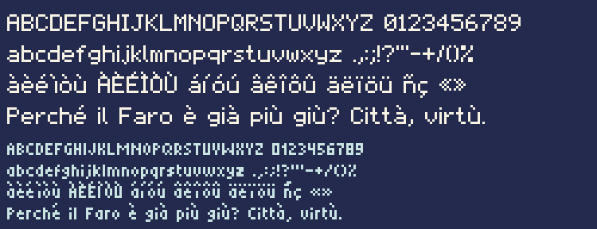

# Guida di stile della pixel art

Questa guida fissa le regole grafiche di **Fari Sommersi**.
Ogni nuovo asset rispetta queste regole.
Gli asset sono nella cartella [`assets/`](../assets/README.md).



## 1. Regole di base

| Regola | Valore |
|---|---|
| Risoluzione della scena | 480 × 270 pixel |
| Scala | Solo fattori interi (×2, ×3, ×4) |
| Filtro delle texture | `nearest` |
| Palette | "Fari 32": 32 colori fissi |
| Contorno | 1 pixel, colore `ink`, solo sul profilo esterno |
| Luce | La luce arriva dall'alto a sinistra |
| Rampa di colore | 3 toni per materiale: ombra, base, luce |
| Sfumature | Dithering ordinato (matrice di Bayer 4 × 4) |

- Non usare colori fuori dalla palette.
- Non usare l'anti-aliasing.
- Non usare il nero puro. Il colore più scuro è `ink`.
- Disegna gli effetti luminosi (fiamme, scintille) sopra il contorno, senza contorno.

## 2. Palette "Fari 32"



Il file [`fari-32.gpl`](../assets/palette/fari-32.gpl) funziona in Aseprite e in GIMP.
Il file [`fari-32.json`](../assets/palette/fari-32.json) serve al codice.

| Gruppo | Colori | Uso |
|---|---|---|
| Neutri | `ink`, `slate`, `stone`, `ash`, `white` | Contorni, roccia, metallo, testo |
| Mare | `abyss`, `deep`, `sea`, `mist`, `foam` | Acqua, cielo, nebbia |
| Fucina | `soot`, `rust`, `ember`, `flame`, `glow` (+ `copper`) | Fuoco, metallo caldo |
| Germoglio | `kelp_dark`, `kelp`, `moss`, `sprout`, `coral` (+ `coral_dark`) | Alghe, corallo |
| Verderame | `verd_dark`, `verd`, `verd_light` | Rame ossidato, interfaccia |
| Terra | `wood_dark`, `wood`, `tan`, `sand` | Legno, pelle, pergamena |
| Crepuscolo | `dusk`, `violet`, `lilac` | Cielo di sera, spiriti del Vespro |

I valori esadecimali sono in [`assets/src/palette.py`](../assets/src/palette.py).

## 3. Fazioni

Ogni fazione ha 5 colori dominanti, una icona e una forma.
La forma aiuta i giocatori daltonici.

| Fazione | Colori dominanti | Icona | Forma |
|---|---|---|---|
| Fucina | `soot`, `rust`, `ember`, `flame`, `glow` | Fiamma | Triangolo |
| Germoglio | `kelp_dark`, `kelp`, `moss`, `sprout`, `coral` | Germoglio | Cerchio |
| Neutrale | `slate`, `stone`, `ash`, `sand`, `white` | Stella a 4 punte | Stella |
| Abisso | `abyss`, `deep`, `sea`, `mist`, `foam` | Goccia | Goccia |
| Ingranaggio | `wood_dark`, `wood`, `copper`, `tan`, `sand` | Ruota dentata | Quadrato |
| Vespro | `dusk`, `violet`, `lilac`, `glow`, `white` | Falce di luna | Rombo |

Le icone misurano 9 × 9 pixel. Le icone sono nel foglio `ui` con il nome `faction/<id>`.

## 4. Carta

La carta misura 64 × 88 pixel.

| Zona | Posizione (x, y) | Dimensione | Contenuto |
|---|---|---|---|
| Illustrazione | 4, 4 | 56 × 40 | Finestra trasparente nella cornice |
| Gemma del costo | centro 7, 7 | raggio 5 | Costo in Brace, font Faro Mini, colore `glow` |
| Targa del nome | 3, 47 | 58 × 15 | 2 righe di Faro Mini, colore `ink`, testo centrato |
| Riquadro del testo | 3, 65 | 58 × 20 | Parole chiave o testo breve |
| Icona di fazione | 28, 75 | 9 × 9 | Già disegnata nella cornice |
| Attacco (solo Custodi) | centro 8, 80 | rombo | Numero in `white` |
| Tenuta (solo Custodi) | centro 55, 80 | scudo | Numero in `white` |

- Disegna prima l'illustrazione, poi la cornice.
- La cornice esiste in 12 varianti: 6 fazioni × 2 tipi (`keeper`, `spell`).
- La variante `spell` serve per Riti, Reliquie e Luoghi.
- Il rombo indica l'Attacco. Lo scudo indica la Tenuta. La forma non dipende dal colore.
- Il testo completo delle regole appare nella vista a schermo intero.

NOTA: il nome più lungo su una riga è "Surriscaldamento" (58 pixel). La targa lo contiene esattamente.



### Illustrazioni

- Un Custode appare nella sua illustrazione con lo stesso sprite del campo. Il giocatore riconosce subito il Custode.
- Ogni fazione ha 3 sfondi.
  - Fucina: sala della forgia, riva al tramonto, fonderia.
  - Germoglio: scogliera sommersa, pozze di marea, foresta di alghe.
  - Abisso: secche di notte, fossa, relitto.
  - Ingranaggio: officina, molo con la gru, stanza dell'orologio.
  - Vespro: riva nella nebbia, cimitero, cripta.
  - Neutrale: porto, ponte della nave, scogliera.
- Un Rito, una Reliquia o un Luogo ha una scena propria.
- Usa i colori dominanti della fazione per almeno metà dell'immagine.

## 5. Custodi

- Lo sprite misura 32 × 32 pixel. I piedi toccano la riga y = 29.
- Il Custode guarda a destra. Il client specchia gli sprite dell'avversario.
- L'animazione di riposo ha 4 fotogrammi. Ogni fotogramma dura 180 ms.
- Il respiro sposta il busto di 1 pixel nei fotogrammi 2 e 3.
- Un movimento secondario (fiamma, alga, mantello) usa un ritmo diverso dal respiro.
- Un Custode piccolo (costo 1–2) è alto circa 20 pixel. Un Custode grande (costo 5+) riempie lo sprite.



## 6. Faro

Lo sprite misura 32 × 48 pixel. Il Faro ha 3 stati con 4 fotogrammi ciascuno.

| Stato | Quando | Aspetto |
|---|---|---|
| `lit` | Luce da 6 a 10 | Lampada gialla, fasci di luce |
| `damaged` | Luce da 1 a 5 | Crepe, tetto rotto, lampada debole e instabile |
| `out` | Luce 0 | Torre grigia, lampada spenta, fumo |

## 7. Tabellone

La scena è una vista laterale. Il giocatore è a sinistra. L'avversario è a destra.
Ogni corsia è una riga orizzontale di 7 celle da 48 × 48 pixel:

```
Faro | Retro | Fronte | Luogo | Fronte | Retro | Faro
```

Ho scelto le corsie orizzontali per 2 motivi.
Sette righe verticali con sprite di 32 pixel non entrano in 270 pixel.
Nella vista laterale i Custodi si guardano in faccia.

- Il file [`board.json`](../assets/sheets/board.json) contiene tutte le coordinate.
- La zona superiore (y da 0 a 25) contiene l'indicatore della Marea e i dati dei giocatori.
- La zona inferiore (y da 178 a 269) contiene la mano.
- L'indicatore della Marea ha 11 celle da 12 pixel. La boa si sposta verso il lato che la Marea favorisce.
- Un punto chiaro segna le soglie di Alta Marea e Riflusso (±2).

## 8. Font

Il progetto usa 2 font originali. Non hanno vincoli di licenza esterni.

| Font | Altezza maiuscola | Altezza riga | Uso |
|---|---|---|---|
| Faro | 7 pixel | 13 pixel | Titoli, interfaccia, numeri di danno |
| Faro Mini | 5 pixel | 9 pixel | Nomi e testi sulle carte |

- I due font sono proporzionali.
- I due font coprono le lettere accentate di italiano, francese, spagnolo e tedesco (senza `ß`).
- Il formato è BMFont (`.fnt` + `.png`). PixiJS carica questo formato con `Assets.load`.
- I glifi sono bianchi. Il client applica il colore con `tint`.



## 9. Nomi dei fotogrammi

| Foglio | Nomi |
|---|---|
| `keepers` | `keeper/<cardId>/idle/<0-3>`, animazione `keeper/<cardId>/idle` |
| `card-art` | `art/<cardId>` |
| `card-frames` | `frame/<fazione>/keeper`, `frame/<fazione>/spell`, `frame/back` |
| `beacon` | `beacon/<stato>/<0-3>`, animazione `beacon/<stato>` |
| `ui` | `faction/*`, `stat/*`, `keyword/*`, `rarity/*`, `panel/*`, `slot/*`, `tide/*`, `fx/*` |

## 10. Come aggiungere un asset

1. Apri il file sorgente giusto in `assets/src/`.
2. Scrivi una funzione che disegna l'asset con le forme di `px.py`.
3. Registra la funzione nel dizionario del file (`KEEPERS`, `SCENES`).
4. Aggiungi l'identificativo della carta a `CARD_IDS` nel file `roster.py`.
5. Esegui `pnpm assets`.
6. Controlla le anteprime in `assets/preview/`.
