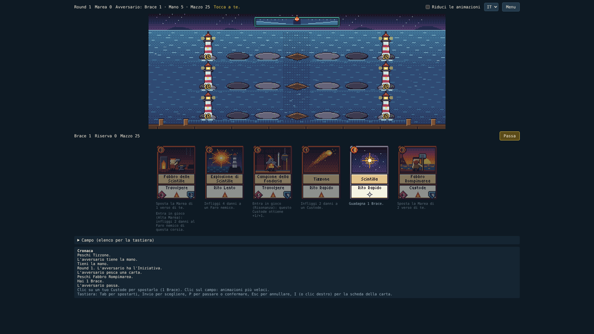
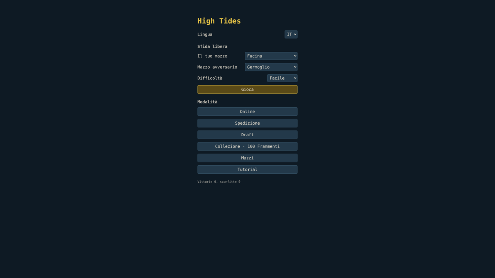
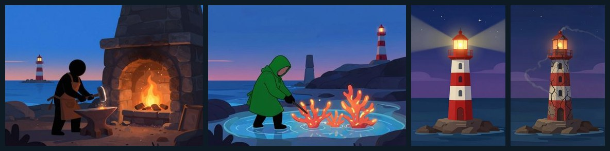
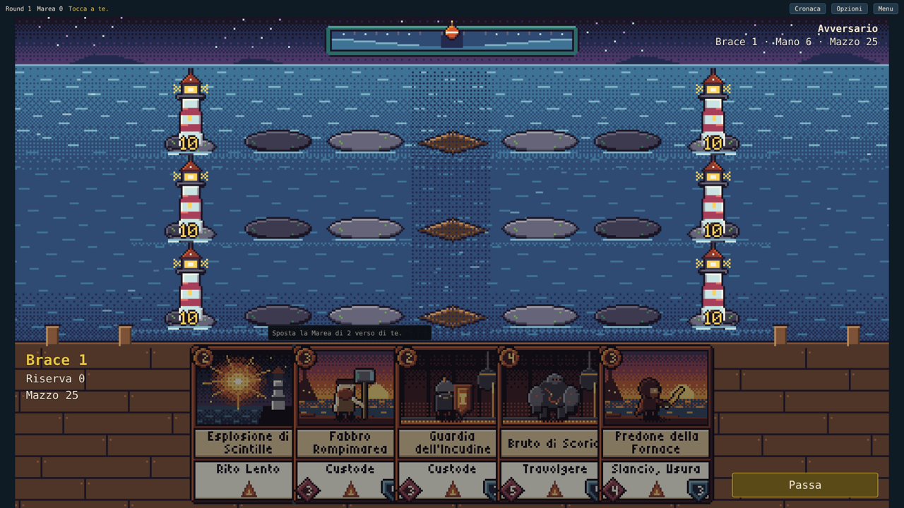
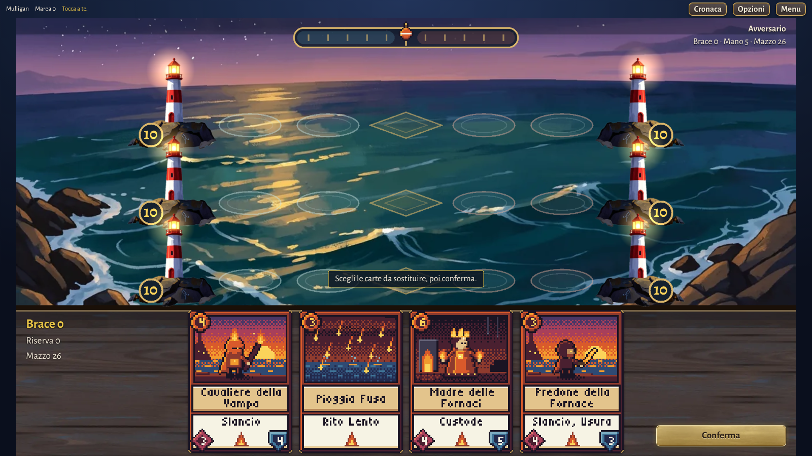

# Piano per la grafica di High Tides

Questo piano porta la grafica di High Tides al livello di un gioco indie finito, come quelli in vendita su Steam.
Il gioco resta un gioco per il browser, con supporto per lo smartphone. Per ora il gioco non va su Steam (Federico, 17/11/2026).
Il piano non cambia le regole del gioco. Il piano cambia il layout, gli asset, l'interfaccia e gli effetti.

**Direzione scelta da Federico (17/11/2026): illustrazioni dipinte in alta risoluzione (opzione C).**
Il gioco abbandona la pixel art. Carte, campo e sfondi diventano illustrazioni dipinte. L'interfaccia diventa vettoriale.

## Indice

1. [Obiettivo](#1-obiettivo)
2. [Stato attuale](#2-stato-attuale)
3. [Direzione artistica](#3-direzione-artistica)
4. [Principi](#4-principi)
5. [Fasi di lavoro](#5-fasi-di-lavoro)
6. [Immagini con i modelli locali](#6-immagini-con-i-modelli-locali)
7. [Modelli di Claude per ogni fase](#7-modelli-di-claude-per-ogni-fase)
8. [Rischi](#8-rischi)
9. [Decisioni](#9-decisioni)
10. [Appendice: pubblicazione su Steam (opzionale)](#10-appendice-pubblicazione-su-steam-opzionale)

## 1. Obiettivo

- Il campo di gioco occupa tutto lo schermo, su desktop e su telefono.
- Ogni schermata (menu, collezione, mazzi, Spedizione, Draft, Online) ha una grafica di gioco, non l'aspetto di un modulo web.
- Le carte hanno illustrazioni dipinte nitide anche a schermo intero.
- Ogni azione ha una risposta visiva chiara: movimento, luce, particelle, suono.
- Il gioco funziona a 60 fotogrammi al secondo sul telefono di fascia media del 2022 (piano di progetto, sezione 7.5).

Criterio di fine: uno screenshot di qualsiasi schermata regge il confronto con un gioco indie commerciale.

## 2. Stato attuale

Ho avviato il client e ho preso screenshot a 1920 × 1080, 1366 × 768 e 412 × 915.



### 2.1 Problemi misurati

| Problema | Causa nel codice | Effetto |
|---|---|---|
| Il campo è piccolo | `Game.svelte` limita la larghezza a 1440 px e l'altezza al 62% della finestra. Poi sceglie una scala intera. | A 1920 × 1080 il campo misura 960 × 372 px: il 17% dello schermo. A 1366 × 768 misura 480 × 186 px. |
| Il campo mostra solo una parte della scena | `VIEW_HEIGHT` = 186 su 270 pixel. La mano è nel DOM, sotto il canvas. | Il campo e la mano sembrano due pagine diverse. |
| Le celle sono minuscole | Celle di 48 px, Custodi di 32 px, scala ×2. | Un Custode misura 64 px su uno schermo di 1080 px. |
| La pagina scorre | Cronaca, elenco del campo e testi delle carte sono blocchi HTML sotto la mano. | Il giocatore scorre la pagina durante la partita. |
| I menu sono moduli web | `App.svelte` usa `<select>` e `<button>` con lo stile del browser e un font monospaziato di sistema. | Il primo impatto è quello di uno strumento, non di un gioco. |
| Le illustrazioni hanno poco dettaglio | Illustrazione di 56 × 40 px. | Una carta ingrandita mostra pochi blocchi di colore. |
| Lo stile non è unico | La plancia è pixel art. Intestazione, mano e cronaca usano testo HTML e bordi arrotondati. | Due stili visivi nella stessa schermata. |



### 2.2 Cosa resta utile

- Le animazioni hanno già anticipazione, hit stop, squash and stretch e dissolvenza (vedi [animazioni.md](animazioni.md)). Queste tecniche valgono anche per le illustrazioni.
- Il codice separa bene il motore, la sessione e il disegno (`Theme`, `BoardView`). Un nuovo tema non tocca le regole.
- La palette "Fari 32" resta come base dei colori di fazione (mare, fari, tramonto). Non è più un limite tecnico.
- Gli asset pixel art restano come tema di riserva finché i nuovi asset non li sostituiscono.

### 2.3 Volume degli asset da produrre

| Asset | Quantità |
|---|---|
| Illustrazioni delle carte | 154 (6 fazioni) |
| Ritratti dei Custodi sul campo | 91 (ritagli delle illustrazioni, vedi fase 5) |
| Cornici delle carte | 12 + dorso |
| Fari | 1 illustrazione × 3 stati, per 6 fazioni o 1 comune |
| Sfondi | campo, titolo, mappa della Spedizione, vittoria, sconfitta |

## 3. Direzione artistica

### 3.1 Lo stile

- **Pittura 2D stilizzata.** Forme semplici, grandi campiture di colore, silhouette chiare. Niente fotorealismo.
- **Luce come tema.** Ogni illustrazione ha una fonte di luce calda (faro, fuoco, lanterna) contro un mare freddo.
- **Personaggi leggibili.** Il soggetto sta in un terzo dell'immagine, con una silhouette che si legge anche in piccolo.
- **Colori di fazione.** Ogni fazione ha i suoi colori dominanti (tabella in [guida-di-stile.md](guida-di-stile.md), sezione 3). I colori dominanti coprono almeno metà dell'immagine.
- **Una frase di stile fissa.** Tutti i prompt finiscono con la stessa frase di stile (sezione 6.4). La frase garantisce la coerenza.

### 3.1.1 Coerenza a due livelli

Federico vuole illustrazioni coerenti tra loro: prima un'identità del gioco, poi un'identità per ogni fazione (17/11/2026).
Quindi le regole hanno due livelli. Il livello del gioco vince sempre sul livello della fazione.

| Livello | Cosa resta uguale | Strumento |
|---|---|---|
| **Gioco** (tutte le 154 carte) | Tecnica pittorica, spessore dei contorni, tipo di luce (calda contro fredda), proporzioni dei personaggi, inquadratura, mondo marino con i fari | 2 **ancore del gioco**: immagini approvate da Federico, presenti come riferimento in ogni generazione. Frase di stile del gioco in ogni prompt. |
| **Fazione** | Colori dominanti, materiali, ambienti, forma dei costumi e degli oggetti | 1–2 **ancore della fazione**. Frase della fazione dopo la frase del gioco. |

- `flux2-klein-4b` accetta fino a 4 immagini di riferimento. Ogni generazione usa 2 riferimenti: l'ancora del gioco 3B e l'ancora della fazione. Con l'ancora 2B il modello copia il ragazzo in ogni carta (prova del 17/11/2026). Formula completa in [guida-di-stile.md](guida-di-stile.md), sezione 4.
- Una carta che non rispetta il livello del gioco viene scartata, anche se rispetta la fazione.
- Controllo: prima del merge, affianca le carte di una fazione e anche le carte di fazioni diverse. Le carte di fazioni diverse devono sembrare dello stesso gioco.

Prove del 17/11/2026 con i modelli locali (anteprime ridotte):



1. Fucina, "Fabbro delle Scintille": `z-image-turbo`, 1344 × 960, circa 70 secondi (primo avvio del modello compreso).
2. Germoglio, un giardiniere delle alghe: `flux2-klein-4b` con l'immagine 1 come riferimento, circa 30 secondi. Lo stile resta coerente con l'immagine 1.
3. Faro acceso: `z-image-turbo`, 768 × 1152, circa 23 secondi.
4. Faro danneggiato: modifica dell'immagine 3 con `flux2-klein-4b`, circa 29 secondi. Punto di vista, scoglio e cielo restano uguali.

Le prove confermano 2 punti. Un'immagine di riferimento tiene coerente lo stile. La modifica crea gli stati del Faro senza ridisegnare la scena.
Un limite: i personaggi hanno spesso il volto in ombra o senza tratti. Il prompt deve chiedere il volto quando serve per il medaglione (fase 5).

### 3.2 Regole tecniche

| Regola | Valore |
|---|---|
| Spazio di progetto | 1920 × 1080. La scena si adatta a ogni schermo con una scala continua (non intera). |
| Densità | `resolution` di PixiJS = `devicePixelRatio`, con un massimo di 2 sul telefono |
| Filtro delle texture | Lineare con mipmap (non più `nearest`) |
| Illustrazione originale | 1344 × 960 (il massimo del modello locale con proporzione 7:5) |
| Illustrazione nel gioco | 3 misure in WebP: 768 × 548 (scheda), 384 × 274 (mano), 192 × 137 (miniatura) |
| Carta in mano | circa 200 × 280 px a 1080p |
| Carta ingrandita | circa 480 × 672 px a 1080p |
| Ritratto del Custode sul campo | medaglione di circa 140 px a 1080p, ritagliato dall'illustrazione |
| Font | Font con licenza OFL, ospitati nel repository. Un font serif per titoli e nomi, un font sans per i testi. |
| Interfaccia | SVG e CSS, con texture dipinte (legno, ottone, carta) dove serve |

NOTA: la scala continua e il filtro lineare sostituiscono le regole 7.1 e 7.2 del piano di progetto (scala intera, filtro `nearest`).

## 4. Principi

1. **Il campo è il protagonista.** Il campo occupa almeno il 60% dello schermo durante la partita.
2. **Una sola scena.** Campo, mano, Brace, Marea e pulsanti stanno nella stessa scena. Il DOM resta per l'accessibilità e per i testi lunghi.
3. **Nessuno scorrimento in partita.** La cronaca diventa un pannello laterale che si apre con un pulsante.
4. **Gerarchia chiara.** Il giocatore vede subito: di chi è il turno, quanta Brace ha, quale carta può giocare, dove la può giocare.
5. **Ogni azione ha una risposta.** Un clic produce sempre un movimento, una luce o un suono entro 100 ms.
6. **Una sola lingua visiva.** Pannelli, pulsanti, cornici e icone usano lo stesso kit.
7. **Leggibilità prima dello stile.** Le regole di accessibilità del piano di progetto (sezione 7.4) restano valide: forma più colore, tastiera, scheda della carta.

## 5. Fasi di lavoro

Ogni fase è una PR separata. Ogni fase ha un criterio di fine verificabile con uno screenshot o un test e2e.

### Fase 0: layout a schermo pieno (subito, solo codice)

Stato: fatta il 17/11/2026 (stessa PR del piano). La mano resta nel DOM, sopra il canvas, con le misure della scena. Le carte diventano sprite PixiJS nella fase 4.



Questa fase dà il miglioramento più grande con il costo più basso. La fase usa ancora gli asset pixel art.

1. Togli il limite di 1440 px e il limite del 62% in `Game.svelte`.
2. Mostra la scena intera, non solo 186 righe.
3. Sposta la mano dentro la scena: le carte diventano sprite PixiJS. Il DOM resta come livello invisibile per tastiera e lettori di schermo.
4. Sposta Brace, Riserva, Mazzo, turno e pulsante "Passa" nella scena.
5. Sposta la cronaca in un pannello laterale apribile. Sposta "Riduci le animazioni" e la lingua in un menu delle opzioni.
6. Introduci lo spazio di progetto 1920 × 1080 con scala continua. `layout.ts` diventa indipendente dalla risoluzione degli asset.
7. Aggiorna i test e2e del layout (desktop 1920 × 1080, laptop 1366 × 768, telefono 412 × 915).

Criterio di fine: a 1920 × 1080 la scena occupa almeno il 90% dello schermo e la pagina non scorre.

### Fase 1: bibbia dello stile

Stato: fatta il 17/11/2026 (PR #21 e PR successiva). Ancore, prompt e carta HD sono in [guida-di-stile.md](guida-di-stile.md).

1. Crea una tavola di riferimento per l'identità del gioco con `z-image-turbo`: 8–12 immagini con fari, mare e personaggi neutri.
2. Scegli con Federico le 2 **ancore del gioco** e la frase di stile del gioco (sezione 3.1.1).
3. Crea una tavola di riferimento per ogni fazione con `flux2-klein-4b` e le ancore del gioco: 6–8 immagini per fazione.
4. Scegli con Federico 1–2 **ancore per ogni fazione** e la frase della fazione.
5. Fissa un modello di prompt per ogni tipo di carta (Custode, Rito, Reliquia, Luogo).
6. Produci 1 carta completa per fazione: illustrazione, cornice, testo.
7. Riscrivi [guida-di-stile.md](guida-di-stile.md) per lo stile dipinto. La versione pixel art resta nella cronologia di git.

Criterio di fine: Federico approva le 6 carte di prova, affiancate. Solo dopo parte la produzione in serie.

### Fase 2: kit dell'interfaccia

Stato: fatta il 17/11/2026. Il kit è in CSS globale (`button`, `select`, `.panel`, `data-tip`), non in componenti Svelte: così ogni schermata lo usa senza modifiche. Le versioni PixiJS (passo 5) passano alla fase 3, insieme alla nuova scena. Dettagli in [guida-di-stile.md](guida-di-stile.md), sezione 9.

1. Scegli i 2 font (licenza OFL) e verifica le lettere accentate.
2. Disegna in SVG pannelli, bordi, pulsanti (4 stati: normale, sopra, premuto, disattivato) e icone.
3. Genera texture di supporto (legno, ottone, pergamena) con `z-image-turbo`. Rendi le texture ripetibili con uno script.
4. Crea componenti Svelte che usano il kit: `Panel`, `Button`, `Select`, `Tooltip`.
5. Crea le versioni PixiJS degli stessi elementi per la scena di gioco.

Criterio di fine: nessun controllo con lo stile del browser in tutto il client.

### Fase 3: campo di gioco

Stato: prima versione il 17/11/2026. Nuovo tema `PaintedTheme` (`packages/client/src/render/paintedTheme.ts`): mare dipinto con onde animate da un filtro, Faro dipinto in 3 stati, celle come anelli di luce, Luogo come rombo dorato, Marea su un righello d'ottone, celle valide con un contorno luminoso. Custodi, Luoghi ed effetti restano in pixel art fino alle fasi 5 e 6. Asset in `assets/board/` (`python3 assets/board/build.py`). Prestazioni sul telefono lento: 50 fps (prima 59).



1. Genera lo sfondo del campo: un mare tra due scogliere, vista dall'alto obliqua, 1920 × 1080 (generato a 1344 × 768 e ingrandito).
2. Disegna le celle come aree luminose sull'acqua, non come scogli disegnati nello sfondo. Lo sfondo non cambia con il layout.
3. Genera il Faro con 3 stati. Genera lo stato acceso con `z-image-turbo`, poi crea gli stati danneggiato e spento con la modifica di `flux2-klein-4b` (stesso faro, stesso punto di vista).
4. Aggiungi lo shader dell'acqua (filtro di spostamento di PixiJS) e il fascio di luce dei Fari.
5. Ridisegna l'indicatore della Marea: un'onda che sale e scende sul lato favorito.
6. Aggiungi l'evidenziazione delle celle valide: contorno luminoso animato, non solo un colore.

Criterio di fine: un giocatore nuovo distingue corsie, file e Fari senza il tutorial.

### Fase 4: carte

1. Disegna le cornici in SVG: 6 fazioni × 2 tipi (`keeper`, `spell`) + dorso. Ogni fazione ha materiale e ornamento propri.
2. Produci le 154 illustrazioni con la pipeline della sezione 6.
3. Crea un atlante delle illustrazioni per la mano, per caricare meno file.
4. Aggiungi l'effetto "lucente" per le carte rare (riflesso animato con uno shader).
5. Mostra la carta ingrandita al passaggio del mouse, accanto alla carta, con il testo completo.
6. Disponi la mano a ventaglio anche su desktop. La carta sotto il puntatore sale e si inclina.

Criterio di fine: il nome, il costo, l'Attacco e la Tenuta si leggono a 1366 × 768 senza ingrandire.

Stato: fatta il 17/11/2026. Tutte le 154 carte del gioco (con le 3 pedine evocate) hanno un'illustrazione dipinta (164 immagini generate sull'OMEN, 23 rifatte). La mano usa `HdCard` a ventaglio, con l'anteprima grande al passaggio del mouse. I Riti hanno una cornice ad arco, ogni fazione ha un emblema, le carte rare e leggendarie hanno un riflesso animato in CSS (non uno shader). Il dorso è `CardBack.svelte`. Il criterio di fine è verificato a 1366 × 768. Passo 3 (atlante) rimandato: la mano carica file `sm` da circa 10 KB (1,4 MB per tutte le carte), uno per carta e solo quando serve. Rivaluta l'atlante nella fase 8, con le misure sul telefono lento.

### Fase 5: Custodi sul campo

Gli sprite animati della pixel art spariscono. Un Custode sul campo diventa un **medaglione**.

1. Ritaglia dall'illustrazione della carta il volto o il busto del Custode. Salva il punto di ritaglio in `assets/art/crops.json`.
2. Mostra il medaglione con il bordo della fazione, l'Attacco a sinistra e la Tenuta a destra.
3. Anima il medaglione con trasformazioni: respiro (scala ±2%), attacco (scatto in avanti), colpo subito (scossa e lampo rosso), morte (dissolvenza con particelle).
4. Aggiungi un'ombra sotto il medaglione e un riflesso sull'acqua.

Criterio di fine: ogni Custode si riconosce dal medaglione a 1366 × 768.

NOTA: questa soluzione evita 91 animazioni a fotogrammi. Le animazioni a fotogrammi con i modelli locali non sono coerenti.

Stato: fatta il 17/11/2026. I 90 Custodi (con le pedine) hanno un medaglione rotondo di 192 px in `assets/art/web/medal/`, ritagliato da `assets/art/build.py` con i punti di `assets/art/crops.json`. `PaintedTheme.keeper` mostra il medaglione con l'anello della fazione, l'Attacco (rombo rosso) e la Tenuta (scudo blu), l'ombra e il riflesso. Il medaglione respira (±2%) e si ferma con "movimento ridotto" o quando il Custode è appena entrato. Il colpo subito ha un lampo rosso. Scatto in avanti (`LaneClash`) e morte (dissolvenza e particelle) esistono già nella plancia (piano di progetto, sezione 7.2). Prestazioni sul telefono lento: 52 fps (prima 50).

### Fase 6: effetti e "juice"

1. Luce dinamica: Fari, lanterne del Vespro, fiamme della Fucina.
2. Particelle per ogni parola chiave (Travolgere, Risonanza, Alta Marea, ...).
3. Numeri di danno grandi con rimbalzo.
4. Transizioni tra le schermate (onda che copre lo schermo).
5. Parallasse leggera dello sfondo con il movimento del mouse.

Criterio di fine: il test `PERF=1 pnpm e2e perf` resta sopra 50 fps.

### Fase 7: menu e schermate secondarie

1. Schermata del titolo: illustrazione del faro nella tempesta, logo, menu verticale.
2. Selezione del mazzo con carte grandi e stendardi delle fazioni, non con `<select>`.
3. Collezione: griglia di carte con filtri a icone e animazione di apertura delle buste.
4. Editor dei mazzi: curva dei costi grafica, trascinamento delle carte.
5. Spedizione: mappa dipinta del viaggio tra isole, un nodo per avversario.
6. Draft: scelta di 1 carta su 3 con carte grandi e animazione.
7. Online: lobby con avatar e stato della connessione.
8. Schermata di vittoria e sconfitta con illustrazione e ricompense animate.

Criterio di fine: ogni schermata rispetta il criterio della sezione 1.

### Fase 8: plancia verticale

Questa fase era già prevista a fine progetto (piano di progetto, sezione 12).
Con lo stile dipinto la plancia verticale è soprattutto un lavoro di layout: spazio di progetto 1080 × 1920, corsie in colonna, uno sfondo verticale nuovo.
Dopo questa fase Federico sceglie: tenere una sola plancia o offrirle entrambe.

### Pulizia finale

Quando tutte le schermate usano i nuovi asset, togli `SpriteTheme`, gli spritesheet pixel art e gli script di `assets/src/` che non servono più.

### Ordine e dipendenze

```
Fase 0 ──► Fase 1 ──► Fase 2 ──► Fase 3 ──► Fase 4 ──► Fase 5 ──► Fase 6 ──► Fase 7 ──► Fase 8
                        (2 e 3 possono andare in parallelo)       (6 può partire dopo la 3)
```

### Fuori da questo piano

- **Audio.** Oggi il gioco non ha suoni né musica. Per ora resta così (Federico, 17/11/2026).

## 6. Immagini con i modelli locali

Federico preferisce generare le immagini sulla sua GPU con `local-image-mcp` (PC OMEN).
Con l'opzione C i modelli locali producono quasi tutte le immagini del gioco.

ATTENZIONE: sull'OMEN usa solo la cartella `tcg`. Non usare mai la cartella `rogue`: contiene un altro gioco.

### 6.1 Modelli disponibili (verificato il 17/11/2026)

| Modello | Funzioni | Licenza | Uso nel progetto |
|---|---|---|---|
| `z-image-turbo` | Testo → immagine | Apache 2.0 | Mood board, prime immagini di ogni fazione, sfondi, key art |
| `flux2-klein-4b` | Testo → immagine, fino a 4 immagini di riferimento, modifica | Apache 2.0 | Produzione in serie con le immagini "ancora", stati del Faro, correzioni |

- Le due licenze permettono l'uso commerciale.
- Limite: 1,57 megapixel per immagine (per esempio 1344 × 960). Lato multiplo di 16.
- Tempi misurati il 17/11: da 23 a 70 secondi per immagine con `z-image-turbo`, circa 30 secondi con `flux2-klein-4b` e un riferimento.

### 6.2 Dove usare i modelli locali

| Uso | Modello | Destinazione |
|---|---|---|
| Mood board delle 6 fazioni | `z-image-turbo` | Solo riferimento |
| 154 illustrazioni delle carte | `flux2-klein-4b` con 2 ancore del gioco + 2 della fazione | Carte, medaglioni dei Custodi |
| Faro (3 stati) | `z-image-turbo`, poi modifica con `flux2-klein-4b` | Campo |
| Sfondo del campo | `z-image-turbo` | Campo |
| Sfondi di titolo, mappa, vittoria e sconfitta | `z-image-turbo` | Menu |
| Texture di legno, ottone, pergamena | `z-image-turbo` | Kit dell'interfaccia |
| Key art (pagina di presentazione, anteprima dei link) | `z-image-turbo` + `flux2-klein-4b` | Sito del gioco |

### 6.3 Dove NON usare i modelli locali

- **Testo dentro le immagini.** I modelli sbagliano le lettere. Il logo, i nomi e i numeri sono testo vero o SVG.
- **Cornici, icone e pulsanti.** Servono forme esatte e ripetibili. Disegna in SVG.
- **Animazioni a fotogrammi.** I modelli non tengono la coerenza tra i fotogrammi. Anima con trasformazioni e shader.

### 6.4 Pipeline delle illustrazioni

1. Scrivi il prompt in inglese con il modello della fase 1: soggetto, scena, composizione, luce, poi la frase del gioco e la frase della fazione.
2. Genera 4 varianti con `flux2-klein-4b` e 4 riferimenti: 2 ancore del gioco e 2 ancore della fazione.
3. Scegli una variante. Controlla silhouette, colori di fazione e assenza di testo.
4. Correggi i difetti (mani, occhi, oggetti in più) con la modifica di `flux2-klein-4b`.
5. Esegui `pnpm art` (nuovo script): ridimensiona nelle 3 misure, converte in WebP, aggiorna l'atlante.
6. Salva prompt, seme, modello e ancore in `assets/art/meta/<cardId>.json`. Il risultato resta riproducibile.
7. Salva l'originale di 1344 × 960 fuori dal repository (sull'OMEN, con una copia di backup). Il repository contiene solo le versioni WebP.

### 6.5 Come lavora un thread con i modelli locali

1. Il thread si collega all'OMEN con la cartella `tcg` approvata.
2. Il thread chiama `generate_image`. Le immagini vanno in `C:\Users\icoma\Pictures\local-image\generated-images\`.
3. Il thread copia le immagini scelte nel container e le elabora con lo script del repository.
4. Il thread mette nel repository solo le versioni WebP e i file `.json`.

NOTA: l'OMEN genera solo durante le sessioni di lavoro con Federico, non di notte (Federico, 17/11/2026). 154 illustrazioni × 4 varianti a circa 30 secondi richiedono circa 5 ore di GPU, più le correzioni. Una fazione (circa 26 carte) richiede circa 1 ora: una fazione per sessione.

### 6.6 Trasparenza sull'IA generativa

Con l'opzione C quasi tutta la grafica nasce dai modelli locali.

- Una pagina "Crediti" nel gioco dichiara: "illustrazioni pregenerate con modelli locali, poi selezionate e ritoccate". Il gioco non genera contenuti durante la partita.
- I file `assets/art/meta/*.json` documentano l'origine di ogni immagine. Questi file servono anche per una futura pubblicazione (appendice, sezione 10).
- Una parte dei giocatori giudica male i giochi con grafica IA. La qualità e la coerenza delle immagini riducono questo rischio.

## 7. Modelli di Claude per ogni fase

La regola del progetto: Opus per tutto, Fable solo dove dà un risultato sensibilmente migliore.
Con l'opzione C i modelli locali dipingono. Claude scrive prompt, sceglie le varianti e scrive il codice. Quindi Opus basta quasi sempre.

| Fase | Modello | Motivo |
|---|---|---|
| 0. Layout a schermo pieno | Opus | Solo codice |
| 1. Bibbia dello stile | Opus | Prompt e scelte con Federico |
| 2. Kit dell'interfaccia | Opus, Fable solo per gli ornamenti SVG delle cornici se Opus non basta | SVG e componenti |
| 3. Campo di gioco | Opus | Immagini locali e shader |
| 4. Carte | Opus | Pipeline e produzione in serie |
| 5. Custodi sul campo | Opus | Ritagli e animazioni con trasformazioni |
| 6. Effetti | Opus | Shader e particelle sono codice |
| 7. Menu | Opus | Layout e immagini locali |
| 8. Plancia verticale | Opus | Layout |

## 8. Rischi

| Rischio | Effetto | Contromisura |
|---|---|---|
| Le 154 illustrazioni non sono coerenti | Carte di stile diverso nella stessa fazione | Usa sempre le ancore del gioco e della fazione (sezione 3.1.1). Controlla le carte affiancate, anche tra fazioni diverse, prima del merge. |
| Difetti tipici dell'IA (mani, occhi, oggetti strani) | Immagini che sembrano sbagliate | Passo di correzione (6.4, punto 4). Composizioni con il soggetto di 3/4 o di spalle quando serve. |
| Giudizio negativo dei giocatori sulla grafica IA | Il gioco sembra meno curato | Dichiarazione chiara, qualità alta, interfaccia e cornici disegnate a mano. |
| Peso del download | Caricamento lento, soprattutto sul telefono | WebP, 3 misure, caricamento progressivo. Obiettivo: meno di 25 MB per tutte le illustrazioni. |
| Le prestazioni calano con shader e illustrazioni grandi | Meno di 60 fps sul telefono | `PERF=1 pnpm e2e perf` dopo ogni fase. Gli effetti pesanti hanno un interruttore. |
| L'OMEN non è raggiungibile | La generazione si ferma | Le fasi 0, 2 (in parte), 5 e 6 non dipendono dai modelli locali. |
| Lavoro pixel art perso | Gli sprite, i font e gli script attuali non servono più | Gli asset restano come tema di riserva fino alla pulizia finale e restano nella cronologia di git. |

## 9. Decisioni

Decisioni prese:

1. **Direzione artistica:** opzione C, illustrazioni dipinte in alta risoluzione (Federico, 17/11/2026).
2. **Piattaforma:** solo browser, con supporto per lo smartphone. Per ora niente Steam (Federico, 17/11/2026).
3. **Fase 0:** parte subito (Federico, 17/11/2026).
4. **Generazione:** l'OMEN genera solo durante le sessioni di lavoro con Federico (17/11/2026).
5. **Audio:** per ora niente audio (Federico, 17/11/2026).
6. **Coerenza:** illustrazioni coerenti prima come gioco, poi per fazione (Federico, 17/11/2026). Vedi la sezione 3.1.1.

## 10. Appendice: pubblicazione su Steam (opzionale)

Questa sezione serve solo se un giorno Federico decide di pubblicare il gioco su Steam. Oggi non fa parte del piano.

- Steam vuole un eseguibile: Electron o Tauri possono incapsulare il client.
- Steam chiede di dichiarare i contenuti creati con l'IA nel questionario dei contenuti (Content Survey). I file `assets/art/meta/*.json` documentano l'origine delle immagini.

Asset per la pagina Steam:

| Asset | Dimensione | Fonte |
|---|---|---|
| Capsula principale | 1232 × 706 | Key art + logo |
| Capsula piccola | 462 × 174 | Logo + dettaglio della key art |
| Capsula verticale | 748 × 896 | Key art verticale |
| Capsula di intestazione | 920 × 430 | Key art + logo |
| Eroe della libreria | 3840 × 1240 | Key art senza logo, ingrandita |
| Logo della libreria | 1280 × 720, trasparente | Logo |
| Copertina della libreria | 600 × 900 | Key art verticale + logo |
| Screenshot | almeno 5, a 1920 × 1080 | Gioco reale |
| Trailer | 30–60 secondi | Gioco reale |

- La key art usa i Fari e i Custodi del gioco. Steam chiede immagini che rappresentano il gioco reale.
- L'eroe della libreria (3840 × 1240) supera il limite del modello. Serve un ingrandimento con un modello di upscaling, o una composizione di più immagini.
- Le dimensioni seguono la documentazione Steamworks. Controlla i valori prima di caricare: Steam a volte li cambia.
