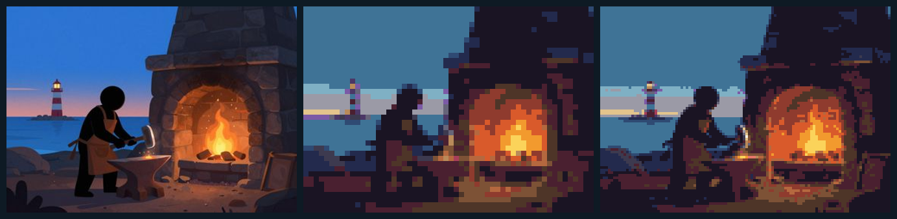

# Piano per la grafica di High Tides

Questo piano porta la grafica di High Tides al livello di un gioco indie vendibile su Steam.
Il piano non cambia le regole del gioco. Il piano cambia il layout, gli asset, l'interfaccia e gli effetti.

## Indice

1. [Obiettivo](#1-obiettivo)
2. [Stato attuale](#2-stato-attuale)
3. [Direzione artistica: la scelta](#3-direzione-artistica-la-scelta)
4. [Principi](#4-principi)
5. [Fasi di lavoro](#5-fasi-di-lavoro)
6. [Immagini con i modelli locali](#6-immagini-con-i-modelli-locali)
7. [Asset per la pagina Steam](#7-asset-per-la-pagina-steam)
8. [Modelli di Claude per ogni fase](#8-modelli-di-claude-per-ogni-fase)
9. [Rischi](#9-rischi)
10. [Decisioni per Federico](#10-decisioni-per-federico)

## 1. Obiettivo

- Il campo di gioco occupa tutto lo schermo, su desktop e su telefono.
- Ogni schermata (menu, collezione, mazzi, Spedizione, Draft, Online) ha una grafica di gioco, non l'aspetto di un modulo web.
- Le carte e i Custodi hanno abbastanza dettaglio per una pagina Steam e per un trailer.
- Ogni azione ha una risposta visiva chiara: movimento, luce, particelle, suono.
- Il gioco funziona a 60 fotogrammi al secondo sul telefono di fascia media del 2022 (obiettivo già fissato nel piano di progetto, sezione 7.5).

Criterio di fine: uno screenshot di qualsiasi schermata può andare sulla pagina Steam senza ritocchi.

## 2. Stato attuale

Ho avviato il client e ho preso screenshot a 1920 × 1080, 1366 × 768 e 412 × 915.


### 2.1 Problemi misurati

| Problema | Causa nel codice | Effetto |
|---|---|---|
| Il campo è piccolo | `Game.svelte` limita la larghezza a 1440 px e l'altezza al 62% della finestra. Poi sceglie una scala intera. | A 1920 × 1080 il campo misura 960 × 372 px: il 17% dello schermo. A 1366 × 768 misura 480 × 186 px. |
| Il campo mostra solo una parte della scena | `VIEW_HEIGHT` = 186 su 270 pixel. La mano è nel DOM, sotto il canvas. | Il campo e la mano sembrano due pagine diverse. |
| Le celle sono minuscole | Celle di 48 px, Custodi di 32 px, scala ×2. | Un Custode misura 64 px su uno schermo di 1080 px. |
| La pagina scorre | Cronaca, elenco del campo e testi delle carte sono blocchi HTML sotto la mano. | Il giocatore scorre la pagina durante la partita. |
| I menu sono moduli web | `App.svelte` usa `<select>` e `<button>` con lo stile del browser e un font monospaziato di sistema. | Il primo impatto è quello di uno strumento, non di un gioco. |
| Le illustrazioni hanno poco dettaglio | Illustrazione di 56 × 40 px. | Una carta ingrandita mostra pochi blocchi di colore. |
| Lo stile non è unico | La plancia è pixel art. Intestazione, mano e cronaca usano testo HTML e bordi arrotondati. | Due stili visivi nella stessa schermata. |


### 2.2 Cosa funziona già

- La palette "Fari 32" è coerente e ha un'identità forte (mare, fari, tramonto).
- I Fari, il mare animato e le cornici delle carte hanno una buona qualità.
- Le animazioni hanno già anticipazione, hit stop, squash and stretch e dissolvenza (vedi [animazioni.md](animazioni.md)).
- Il codice separa bene il motore, la sessione e il disegno (`Theme`, `BoardView`). Un nuovo layout non tocca le regole.
- Gli asset nascono da script Python (`assets/src/`). Il processo è ripetibile.

### 2.3 Volume degli asset

| Asset | Quantità oggi |
|---|---|
| Carte | 154 (6 fazioni) |
| Illustrazioni delle carte | 154, di 56 × 40 px |
| Sprite dei Custodi | 91, di 32 × 32 px, 4 fotogrammi |
| Cornici delle carte | 12 + dorso |
| Fari | 3 stati × 4 fotogrammi |

## 3. Direzione artistica: la scelta

La scelta principale è la risoluzione della pixel art. La scelta decide il costo di tutte le fasi successive.

| Opzione | Descrizione | Pro | Contro |
|---|---|---|---|
| **A. Pixel art più grande (consigliata)** | Scena di base 640 × 360. Celle di 64 px. Custodi di 48 × 48 px. Illustrazioni di 112 × 80 px. | 640 × 360 riempie esattamente 720p (×2), 1080p (×3), 1440p (×4) e 4K (×6). Più dettaglio per le carte. Lo stile resta quello attuale. | Bisogna ridisegnare 91 Custodi e 154 illustrazioni. |
| B. Pixel art attuale, layout nuovo | Scena di base 480 × 270. Solo layout a schermo pieno, interfaccia ed effetti. | Costo basso. Nessun asset da ridisegnare. | Le illustrazioni restano di 56 × 40 px. Il dettaglio resta basso per una pagina Steam. 480 × 270 riempie male 1366 × 768 e lo Steam Deck. |
| C. Illustrazioni dipinte in alta risoluzione | Carte e sfondi dipinti (con i modelli locali). Interfaccia vettoriale. Niente pixel art. | Massimo impatto visivo sulle carte. Le immagini locali vanno quasi dirette nel gioco. | Perde il lavoro fatto e l'identità attuale. La coerenza tra 154 immagini è difficile. Gli sprite animati dei Custodi diventano un problema. |

Consiglio l'opzione A. Il motivo: la pixel art più grande tiene l'identità attuale e dà il dettaglio che manca.
La fase 0 (layout a schermo pieno) serve a tutte e tre le opzioni. Quindi la fase 0 può partire subito.

### 3.1 Regole tecniche dell'opzione A

| Regola | Valore |
|---|---|
| Scena di base | 640 × 360 pixel |
| Scala | Intera, poi un filtro "sharp bilinear" porta la scena alla dimensione esatta dello schermo, senza bordi neri |
| Cella del campo | 64 × 64 px |
| Custode | Sprite di 48 × 48 px. Riposo di 4 fotogrammi. Attacco e colpo subito di 3 fotogrammi. |
| Faro | 40 × 64 px |
| Carta in mano | 80 × 112 px. Illustrazione di 72 × 52 px. |
| Carta ingrandita | 160 × 224 px (scala ×2 della carta, con un'illustrazione dedicata di 144 × 104 px) |
| Palette | "Fari 32", con al massimo 8 colori nuovi per luci e interfaccia |
| Font | Faro e Faro Mini restano per i numeri. Un nuovo font pixel di 9–11 px per i testi lunghi. |

NOTA: il filtro "sharp bilinear" tiene i pixel nitidi anche con una scala non intera. Lo usano molti giochi pixel art su Steam.

## 4. Principi

1. **Il campo è il protagonista.** Il campo occupa almeno il 60% dello schermo durante la partita.
2. **Una sola scena.** Campo, mano, Brace, Marea e pulsanti stanno nella stessa scena pixel art. Il DOM resta solo per l'accessibilità e per i testi lunghi.
3. **Nessuno scorrimento in partita.** La cronaca diventa un pannello laterale che si apre con un pulsante.
4. **Gerarchia chiara.** Il giocatore vede subito: di chi è il turno, quanta Brace ha, quale carta può giocare, dove la può giocare.
5. **Ogni azione ha una risposta.** Un clic produce sempre un movimento, una luce o un suono entro 100 ms.
6. **Una sola lingua visiva.** Pannelli, pulsanti, cornici e icone usano lo stesso kit (bordi a 9 sezioni, palette, font).
7. **Leggibilità prima dello stile.** Le regole di accessibilità del piano di progetto (sezione 7.4) restano valide: forma più colore, tastiera, scheda della carta.

## 5. Fasi di lavoro

Ogni fase è una PR separata. Ogni fase ha un criterio di fine verificabile con uno screenshot o un test e2e.

### Fase 0: layout a schermo pieno (subito, solo codice)

Questa fase dà il miglioramento più grande con il costo più basso. La fase usa gli asset attuali.

1. Togli il limite di 1440 px e il limite del 62% in `Game.svelte`.
2. Mostra la scena intera (270 righe), non solo 186.
3. Sposta la mano dentro la scena: le carte diventano sprite PixiJS. Il DOM resta come livello invisibile per tastiera e lettori di schermo.
4. Sposta Brace, Riserva, Mazzo, turno e pulsante "Passa" nella scena.
5. Sposta la cronaca in un pannello laterale apribile. Sposta "Riduci le animazioni" e la lingua in un menu delle opzioni.
6. Aggiungi il filtro "sharp bilinear" per riempire lo schermo senza bordi.
7. Aggiorna i test e2e del layout (desktop 1920 × 1080, laptop 1366 × 768, telefono 412 × 915).

Criterio di fine: a 1920 × 1080 la scena occupa almeno il 90% dello schermo e la pagina non scorre.

### Fase 1: guida di stile e prove (direzione artistica)

1. Crea una tavola di riferimento (mood board) per ogni fazione con i modelli locali (vedi sezione 6).
2. Ridisegna 1 Custode, 1 illustrazione, 1 cornice e 1 Faro per ogni fazione alla nuova risoluzione.
3. Monta una scena di prova a 640 × 360 con questi asset.
4. Aggiorna [guida-di-stile.md](guida-di-stile.md) con le nuove misure.

Criterio di fine: Federico approva la scena di prova. Solo dopo parte la produzione in serie.

### Fase 2: kit dell'interfaccia

1. Disegna pannelli e bordi a 9 sezioni (legno, ottone, vetro di lanterna).
2. Disegna pulsanti con 4 stati: normale, sopra, premuto, disattivato.
3. Disegna icone per Brace, Riserva, Mazzo, Marea, Iniziativa, opzioni, cronaca.
4. Crea il nuovo font per i testi lunghi (italiano e inglese, lettere accentate).
5. Crea componenti Svelte che usano il kit: `PixelPanel`, `PixelButton`, `PixelSelect`, `Tooltip`.

Criterio di fine: nessun controllo con lo stile del browser in tutto il client.

### Fase 3: campo di gioco

1. Ridisegna il campo a 640 × 360: mare, scogli delle celle, Luogo centrale, molo in basso.
2. Ridisegna i 3 stati del Faro a 40 × 64 px. Aggiungi il fascio di luce che ruota.
3. Rendi visibili le corsie: una luce tenue o una boa per ogni corsia.
4. Ridisegna l'indicatore della Marea: un'onda che sale e scende sul lato favorito.
5. Aggiungi lo sfondo con parallasse a 3 livelli: cielo, isole lontane, mare vicino.
6. Aggiungi l'evidenziazione delle celle valide: contorno animato, non solo un colore.

Criterio di fine: un giocatore nuovo distingue corsie, file e Fari senza il tutorial.

### Fase 4: carte

1. Ridisegna le 12 cornici e il dorso a 80 × 112 px. Ogni fazione ha materiale e ornamento propri.
2. Produci le 154 illustrazioni a 72 × 52 px con la pipeline della sezione 6.
3. Aggiungi l'effetto "lucente" per le carte rare (scambio di palette e riflesso animato).
4. Mostra la carta ingrandita al passaggio del mouse, accanto alla carta, con il testo completo.
5. Disponi la mano a ventaglio anche su desktop. La carta sotto il puntatore sale e si inclina.

Criterio di fine: il nome, il costo, l'Attacco e la Tenuta si leggono a 1366 × 768 senza ingrandire.

### Fase 5: Custodi

1. Ridisegna i 91 Custodi a 48 × 48 px.
2. Aggiungi le animazioni di attacco (3 fotogrammi) e di colpo subito (2 fotogrammi).
3. Aggiungi un'ombra sotto ogni Custode e una base colorata della fazione.
4. Mostra Attacco e Tenuta come targhette sotto lo sprite, con numeri grandi.

Criterio di fine: ogni Custode si riconosce dalla sola silhouette nera.

### Fase 6: effetti e "juice"

1. Shader dell'acqua con riflessi dei Fari.
2. Luce dinamica a griglia: Fari, lanterne del Vespro, fiamme della Fucina.
3. Particelle per ogni parola chiave (Travolgere, Risonanza, Alta Marea, ...).
4. Numeri di danno grandi con rimbalzo.
5. Transizioni tra le schermate (onda che copre lo schermo).
6. Un'opzione per un filtro CRT leggero (disattivato di default).

Criterio di fine: il test `PERF=1 pnpm e2e perf` resta sopra 50 fps.

### Fase 7: menu e schermate secondarie

1. Schermata del titolo: logo pixel art, scena animata del faro nella tempesta, menu verticale.
2. Selezione del mazzo con carte grandi e stendardi delle fazioni, non con `<select>`.
3. Collezione: griglia di carte con filtri a icone e animazione di apertura delle buste.
4. Editor dei mazzi: curva dei costi grafica, trascinamento delle carte.
5. Spedizione: mappa del viaggio tra isole, un nodo per avversario.
6. Draft: scelta di 1 carta su 3 con carte grandi e animazione.
7. Online: lobby con avatar e stato della connessione.
8. Schermata di vittoria e sconfitta con illustrazione e ricompense animate.

Criterio di fine: ogni schermata ha uno screenshot di qualità Steam (sezione 1).

### Fase 8: asset per la pagina Steam

Vedi la [sezione 7](#7-asset-per-la-pagina-steam).

### Fase 9: plancia verticale

Questa fase era già prevista a fine progetto (piano di progetto, sezione 12).
Con la scena a 640 × 360, la versione verticale usa 360 × 640 con le corsie in colonna.
Dopo questa fase Federico sceglie: tenere una sola plancia o offrirle entrambe.

### Ordine e dipendenze

```
Fase 0 ──► Fase 1 ──► Fase 2 ──► Fase 3 ──► Fase 4 ──► Fase 5 ──► Fase 6 ──► Fase 7 ──► Fase 8 ──► Fase 9
                        (2 e 3 possono andare in parallelo)       (6 può partire dopo la 3)
```

### Fuori da questo piano, ma necessario per Steam

- **Audio.** Oggi il gioco non ha suoni né musica. Un gioco senza audio sembra incompleto. Serve un piano separato.
- **Client desktop.** Steam vuole un eseguibile. Electron o Tauri possono incapsulare il client. Serve un piano separato.

## 6. Immagini con i modelli locali

Federico preferisce generare le immagini sulla sua GPU con `local-image-mcp` (PC OMEN).

ATTENZIONE: sull'OMEN usa solo la cartella `tcg`. Non usare mai la cartella `rogue`: contiene un altro gioco.

### 6.1 Modelli disponibili (verificato il 17/11/2026)

| Modello | Funzioni | Licenza | Uso nel progetto |
|---|---|---|---|
| `z-image-turbo` | Testo → immagine | Apache 2.0 | Concept art, mood board, sfondi, key art per Steam |
| `flux2-klein-4b` | Testo → immagine, fino a 4 immagini di riferimento, modifica | Apache 2.0 | Serie coerenti (stesso Custode in più scene), varianti, modifiche a un'immagine esistente |

- Le due licenze permettono l'uso commerciale.
- Limite: 1,57 megapixel per immagine (per esempio 1344 × 960). Lato multiplo di 16.
- Una immagine di 1344 × 960 richiede circa 70 secondi (prova del 17/11, primo avvio del modello compreso).

### 6.2 Dove usare i modelli locali

| Uso | Modello | Risultato nel gioco |
|---|---|---|
| Mood board delle 6 fazioni | `z-image-turbo` | Solo riferimento, non entra nel gioco |
| Base delle 154 illustrazioni | `z-image-turbo`, poi `flux2-klein-4b` per la coerenza | Pixelizzazione + pulizia (sezione 6.3) |
| Sfondi del titolo, della mappa della Spedizione e delle schermate finali | `z-image-turbo` | Pixelizzazione a 640 × 360 + pulizia |
| Sfondi con parallasse del campo | `z-image-turbo` | Pixelizzazione, poi separazione in 3 livelli |
| Key art per Steam (capsule, eroe della libreria) | `z-image-turbo` + `flux2-klein-4b` (modifica) | Versione in alta risoluzione, coerente con il gioco |
| Concept dei Custodi (pose, silhouette) | `z-image-turbo` | Solo riferimento per il disegno a mano |

### 6.3 Dove NON usare i modelli locali

- **Sprite animati dei Custodi.** I modelli non tengono la coerenza tra i fotogrammi. Disegna lo sprite a mano (script `px.py`), poi crea i fotogrammi con il codice.
- **Kit dell'interfaccia e font.** Servono pixel esatti e bordi a 9 sezioni. Disegna a mano.
- **Icone piccole (9 × 9, 16 × 16).** A queste dimensioni ogni pixel conta.
- **Testo dentro le immagini.** I modelli sbagliano le lettere. Il logo è disegnato a mano.

### 6.4 Pipeline "immagine → pixel art"

1. Scrivi il prompt in inglese: soggetto, scena, composizione, luce, stile. Chiedi forme semplici e silhouette chiare.
2. Genera 4 varianti con semi diversi.
3. Scegli una variante.
4. Esegui `pnpm pixelize` (nuovo script in `assets/src/pixelize.py`): riduzione con filtro "box", contrasto, quantizzazione sulla palette "Fari 32".
5. Esegui la pulizia automatica: togli i pixel isolati, aggiungi il contorno `ink` al soggetto, applica il dithering di Bayer 4 × 4 solo sui cieli.
6. Ritocca a mano i punti critici: occhi, mani, bordi del soggetto.
7. Salva prompt, seme e modello in `assets/ai/<cardId>.json`. Il risultato resta riproducibile.

Prova del 17/11/2026 sulla carta "Fabbro delle Scintille":



Da sinistra: immagine generata, pixelizzazione a 56 × 40 (risoluzione attuale), pixelizzazione a 112 × 80.

- A 56 × 40 il soggetto si perde. Questo conferma il limite della risoluzione attuale.
- A 112 × 80 il fabbro, il fuoco e il faro si leggono. Mancano ancora il contorno e la pulizia del passo 5.
- La conversione automatica non basta da sola. La pulizia dei passi 5 e 6 è necessaria.

### 6.5 Come lavora un thread con i modelli locali

1. Il thread si collega all'OMEN con la cartella `tcg` approvata.
2. Il thread chiama `generate_image`. Le immagini vanno in `C:\Users\icoma\Pictures\local-image\generated-images\`.
3. Il thread copia le immagini scelte nel container e le pixelizza con lo script del repository.
4. Il thread mette solo il risultato pixelizzato e il file `.json` del prompt nel repository. Le immagini grandi restano fuori dal repository.

NOTA: l'OMEN deve restare acceso durante la generazione. 154 illustrazioni × 4 varianti richiedono circa 3–5 ore di GPU. Conviene generare di notte, una fazione per notte.

### 6.6 Steam e l'IA generativa

Steam chiede di dichiarare i contenuti creati con l'IA nel questionario dei contenuti (Content Survey).
Il gioco dichiara: "immagini pregenerate con modelli locali, poi ritoccate a mano". Il gioco non genera contenuti durante la partita.
I file `assets/ai/*.json` documentano l'origine di ogni immagine.

## 7. Asset per la pagina Steam

| Asset | Dimensione | Fonte |
|---|---|---|
| Capsula principale | 1232 × 706 | Key art + logo |
| Capsula piccola | 462 × 174 | Logo + dettaglio della key art |
| Capsula verticale | 748 × 896 | Key art verticale |
| Capsula di intestazione | 920 × 430 | Key art + logo |
| Eroe della libreria | 3840 × 1240 | Key art senza logo |
| Logo della libreria | 1280 × 720, trasparente | Logo |
| Copertina della libreria | 600 × 900 | Key art verticale + logo |
| Screenshot | almeno 5, a 1920 × 1080 | Gioco reale |
| Trailer | 30–60 secondi | Gioco reale |

- La key art nasce con i modelli locali. Poi un passaggio di pixelizzazione "morbida" la avvicina allo stile del gioco.
- Steam chiede che le immagini mostrino il gioco reale. La key art usa i Custodi e i Fari del gioco.
- Le dimensioni seguono la documentazione Steamworks. Controlla i valori prima di caricare: Steam a volte li cambia.

## 8. Modelli di Claude per ogni fase

La regola del progetto: Opus per tutto, Fable solo dove dà un risultato sensibilmente migliore.

| Fase | Modello | Motivo |
|---|---|---|
| 0. Layout a schermo pieno | Opus | Solo codice |
| 1. Guida di stile e prove | Fable | Pixel art nuova e scelte di stile |
| 2. Kit dell'interfaccia | Opus per i componenti, Fable per i 9 sezioni e il font | Il disegno dei pixel richiede Fable |
| 3. Campo di gioco | Fable | Pixel art nuova |
| 4. Carte | Opus per la pipeline e le 154 illustrazioni, Fable per le cornici | Le illustrazioni nascono dai modelli locali. Opus guida la pipeline e il ritocco. |
| 5. Custodi | Fable | 91 sprite con animazioni |
| 6. Effetti | Opus | Shader e particelle sono codice |
| 7. Menu | Opus, Fable solo per il logo e la mappa | Quasi tutto è layout |
| 8. Steam | Opus | Key art dai modelli locali |
| 9. Plancia verticale | Fable per la grafica, Opus per il codice | Pixel art nuova |

NOTA: la fase 5 è la più costosa con Fable. Un'alternativa: Fable disegna 1 Custode per fazione come modello, poi Opus produce gli altri con gli stessi script.

## 9. Rischi

| Rischio | Effetto | Contromisura |
|---|---|---|
| Le illustrazioni dai modelli locali non sono coerenti | Carte di stile diverso nella stessa fazione | Usa `flux2-klein-4b` con 2–4 immagini di riferimento approvate. Usa la stessa frase di stile in tutti i prompt. |
| La pulizia a mano richiede troppo tempo | La fase 4 si allunga | Migliora la pulizia automatica prima di partire. Misura il tempo sulle prime 10 carte. |
| Il ridisegno a 640 × 360 rompe il layout del telefono | Problemi sul telefono | I test e2e su 412 × 915 restano nella CI. |
| Le prestazioni calano con shader e parallasse | Meno di 60 fps sul telefono | `PERF=1 pnpm e2e perf` dopo ogni fase. Gli effetti pesanti hanno un interruttore. |
| L'OMEN non è raggiungibile | La generazione si ferma | Le fasi 0, 2, 3, 5 e 6 non dipendono dai modelli locali. |

## 10. Decisioni per Federico

1. **Direzione artistica:** opzione A (pixel art 640 × 360, consigliata), B (asset attuali) o C (illustrazioni dipinte).
2. **Fase 0:** può partire subito? La fase 0 serve a tutte le opzioni.
3. **Generazione notturna:** l'OMEN può restare acceso di notte per le illustrazioni?
4. **Audio e client desktop:** apro due piani separati?
